<div align="center">


# 🐂 牛来选股面板 · Niucap

**本地自托管的 A 股量化「选股 + 择时 + 复盘」一体化面板**

*29 个选股策略 · 实时行情 · 连板梯队 · 题材雷达 · 龙虎榜后验 · 双源快讯 · 策略回测 · 虚拟盘 · 选股复盘闭环 · 因子实验室 · 牛熊温度计 · 昼夜双主题 · 命令面板*

<br>

<a href="https://ab1dde4ffb5e275c5.app.workbuddy.host/" target="_blank"></a>

<sub>免安装 · 打开即用 · 演示环境数据仅供预览</sub>

<br>

[](https://gitee.com/jangviktor/niucap)
[](CHANGELOG.md)


[](LICENSE)
[](https://www.python.org/)
[](https://fastapi.tiangolo.com/)
[](#-5-分钟跑起来)
[](#-5-分钟跑起来)
[](#-5-分钟跑起来)

</div>

<br>

<div align="center">

<table><tr>
<td align="center" width="25%">
<b>⚡ 在线体验</b><br>
<sub>免安装，打开就用</sub><br><br>
<a href="https://ab1dde4ffb5e275c5.app.workbuddy.host/" target="_blank"><b>立即体验 →</b></a>
</td>
<td align="center" width="25%">
<b>🚀 5 分钟跑起来</b><br>
<sub>本机 Python / Docker 任选</sub><br><br>
<a href="#-5-分钟跑起来"><b>看步骤 →</b></a>
</td>
<td align="center" width="25%">
<b>☁️ 不想运维？云平台一键发布</b><br>
<sub>零服务器，出分享链接</sub><br><br>
<a href="#-部署教程一键发布到-workbuddy-云平台"><b>看教程 →</b></a>
</td>
<td align="center" width="25%">
<b>🎯 先看它能干什么</b><br>
<sub>16 张实机截图 + 功能说明</sub><br><br>
<a href="#-页面预览"><b>看预览 →</b></a>
</td>
</tr></table>

</div>

<br>

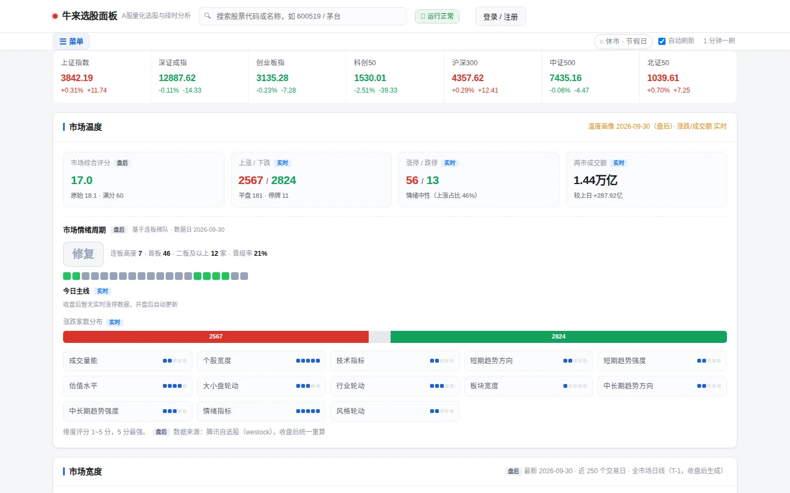

<div align="center">

> 仓库名 `niucap`（牛 = capture 牛股，A 股梗）；产品中文名「牛来选股面板」。两者指同一个项目。
>
> **A self-hosted A-share quant dashboard** — screening, limit-up ladder, sector radar, backtesting & paper trading. **No API key. 100% local.**

</div>

---

## 🎯 为什么用它

<div class="fgrid">

<div class="fcard">
<h4>🔑 零 API Key，一条命令起</h4>
<p>行情全部走腾讯 / 新浪 / 同花顺 / 东财公开接口，情绪分析是本地词典引擎。不注册、不付费、不限流，克隆下来跑起来就能用。</p>
</div>

<div class="fcard">
<h4>⚡ 秒级全市场扫描</h4>
<p>29 个内置策略 + 六类分组（趋势形态 / 量价涨停 / 反转波动 / 形态相似度 / 经典指标 / 分钟级），并集交集自由组合，全市场扫描稳定在秒级。</p>
</div>

<div class="fcard">
<h4>🔒 数据在自己手里</h4>
<p>SQLite 本地库或云端 MySQL 协议库自适应，日线数据落盘自己掌控。不是把隐私交出去的网页版。</p>
</div>

<div class="fcard">
<h4>🧠 选完还能复盘</h4>
<p>每次选股自动存档，事后可回看<b>窗口胜率</b>（模拟 09:30–09:50 买入当日收盘结算）、<b>入选后表现</b>、批量沉淀自选——不靠记性判断策略好坏。</p>
</div>

</div>

---

## 📑 目录

<details open>
<summary><b>展开 / 收起目录</b></summary>

- [🎯 为什么用它](#-为什么用它)
- [✨ 功能总览](#-功能总览)
- [🖼 页面预览](#-页面预览)
- [🐂 牛熊速查 + 🌗 昼夜主题（v1.1.0 新增）](#-牛熊速查--昼夜主题v110-新增)
- [🧪 因子实验室：IC/ICIR 因子检验（v1.1.0 新增）](#-因子实验室icicir-因子检验v110-新增)
- [🧪 选股复盘闭环（#103~#105 新增）](#-选股复盘闭环103105-新增)
- [🚀 5 分钟跑起来](#-5-分钟跑起来)
- [💡 快速上手示例](#-快速上手示例)
- [🧱 技术栈](#-技术栈)
- [📘 部署教程：一键发布到 WorkBuddy 云平台](#-部署教程一键发布到-workbuddy-云平台)
- [⚠️ 首次部署必读：数据初始化](#-首次部署必读数据初始化)
- [⚙️ 配置（.env，可选）](#-配置env可选)
- [🔐 默认管理员账号](#-默认管理员账号)
- [🔒 登录要求：哪些功能需要账号](#-登录要求哪些功能需要账号)
- [📁 目录结构](#-目录结构)
- [🤝 贡献方式](#-贡献方式)
- [🗺️ 路线图](#-路线图)
- [📝 更新日志](CHANGELOG.md)
- [❓ 常见问题](#-常见问题)
- [📜 许可证](#-许可证)

</details>

---

## ✨ 功能总览

| 模块 | 说明 |
|---|---|
| 🌟 **小白选股** | 完全不懂 K 线也能用：四套方案（稳健白马 / 超跌反弹 / 成长活跃 / 打板热点）一键出结果，每只票给 0~100 友好度评分 + 大白话逐条解释「为什么选它」；**需登录** |
| 🔍 **策略选股** | 29 个内置策略（趋势形态 / 量价涨停 / 反转波动 / 形态相似度 / 经典指标 / 分钟级），支持并集 / 交集组合，秒级扫描全市场；**需登录** |
| 🎯 **条件选股** | PE / PB / 市值 / 涨跌幅 / 换手率 / 成交额自由组合，内置四套预设；底层已升级为**通用筛选引擎**（16 个可筛字段 × 10 个算子），加一个字段只需改一行；还支持**一句话选股**（自然语言 → 条件，如「市盈率小于20，换手率介于3%到15%，名称包含银行」）；另支持**按需加载指标评级**（点「📊 加载指标评级」按当前页计算买入/卖出/中性徽标）；另有分钟级全市场实时扫描。以上选股类功能**需注册登录后使用** —— 点「执行」时弹登录框，登录成功自动续跑刚才那次操作 |
| 📈 **个股分析** | 日/周/月 K 线叠加 MA + 布林 / 唐安奇 / 肯特纳 / 吊灯止损通道；MACD / RSI / KDJ / 成交量；60+ 项技术指标与自动信号；**每项指标附多空评级**（买入=红 / 卖出=绿，由阈值区间实时计算，与「信号事件」相互独立）；关键价位；资金流向 / 筹码分布 / 基本面 / 研报公告；**✨ AI 深度分析卡片**（进页自动分析 + 30 分钟缓存，「大白话」开关切换小白视角，见下方 AI 增强行） |
| 🔥 **连板梯队 + 情绪周期** | 涨停子集取近 12 日 K 线算连板天数（交易日历对齐），按首板 / 2 板 / 3 板 / 4+ 板分组；融合 6 阶段市场情绪（冰点→启动→主升→高潮→退潮→修复） |
| 🎯 **题材雷达** | 行业板块四维评分（强度 / 资金 / 宽度 / 持续）+ 名称归一融合去重，一眼锁定当日最强主线 |
| 🧪 **策略回测** | T+1 / 手续费 / 印花税 / 滑点真实约束，止损止盈、金字塔分批加仓；净值曲线、年化、最大回撤、夏普、卡玛、胜率、盈亏比；网格回测与走查（防过拟合）；自然语言策略描述支持 **✨AI 增强解析**（需 LLM Key，见下方 AI 增强行） |
| 📊 **市场榜单** | 涨幅 / 跌幅 / 成交额 / 换手率 / 市值 / 低估值六大榜单 + 市场温度（**盘中实时综合评分**：集合竞价/盘中/午休/收盘后当日显示合成评分（涨跌家数 / 涨停跌停 / 量能合成 0-60 量表，交易时段每 60s 刷新、收盘后冻结并标「收盘」），盘前/周末/节假日回落西财 13 维盘后评分）+ 市场宽度（**今日实时广度**：涨跌家数 / 涨停跌停，交易时段每 60s 刷新、收盘后冻结；站上 20 日线比例、新高新低、Chop 为 T-1 盘后）+ 市场情绪周期（**实时连板梯队**：高度 / 首板 / 二板 / 晋级率 + 盘中热度 + 今日主线，交易时段每 60s 刷新、收盘后冻结；6 阶段定级为 T-1 盘后）+ **🌐 宏观风向**（降息概率 / 10Y 美债实际利率 / 10Y-2Y 期限利差 / 恐慌指数，同花顺黄金数据中心日更 T-1）+ **🥇 黄金行情**（伦敦金现 / 三家银行积存金 / AU9999 / AUTD 六品种，60s 刷新，涨红跌绿） |
| 🐯 **龙虎榜后验** | 上榜原因 + D+1 / D+2 / D+5 / D+10 复权涨幅，把名单变成绩单 |
| 📰 **双源快讯** | 新浪 7×24 + 同花顺双源互备，30s 缓存，重大红条标记，词典情绪自动打「看涨 / 看跌 / 中性」，关联股票可点跳个股页 |
| 🌐 **全球领先信号** | **交易日**抓两次 64 个海外权威源（半导体设备 / OpenAI / OPEC / 美联储…）聚成中文要点，挂「板块舆情」页：早盘 09:15（赶在开盘前备好隔夜摘要）+ 午间 12:45（补覆盖上午才出的消息）；周末/节假日不抓。**板块归因内容优先**：先扫标题关键词（已校准的中英词表），扫不到才用源的赛道——实测修掉「乌克兰袭击俄炼油厂」错归新能源、「NASA 天文旧闻」错归军工，军工故事数从 14 塌到 1。**方向由 LLM 判**（利好/利空/中性，词表已实测证伪删掉）：`1.6%` 命中的英文词表匹配不上科技媒体口语体标题。**story 合并**：同一通讯社稿被 N 家转只算 1 条并标「N源」；源数按 `1+0.35×log2(N)` 亚线性加权，多源共识再乘到方向权重上。要点带 ↗ 溯源原文，AI 提炼可一键关闭 |
| ⚖️ **多股对比** | 最多 8 只同屏对比价格 / RSI / MACD / KDJ / 量比 / 估值，自动标注组内最优 / 最差；每只票附**指标多空评级徽标**（买/卖/中），「强弱速览」顶部汇总各组评级分布 |
| ⭐ **我的自选** | 自选股分组、成本线、批量盯盘 |
| 🧪 **选股历史存档** | 每次选股自动存档，事后回看：窗口胜率回测（09:30–09:50 买入当日收盘结算）、入选后表现、批量加自选 |
| 💰 **虚拟盘** | 费率可配，盈亏跟踪，T+1 / 费用 / 滑点约束；收盘后自动禁止交易（#103） |
| 📅 **本地交易日历** | 内置 A 股节假日表，休市/补班自动识别，连板天数与选股按交易日对齐（#104）；另与同花顺权威日历**自动对账**，本地判定有偏差会在自检里报警（#107） |
| 🌅 **盘前竞价** | 竞价日（9:15–9:25）展示**我的自选集合竞价**涨幅 / 量比 / 占昨量，以及**短线风向标**全市场竞价基准 + 概念归因标签；休市日自动回落到上一交易日终态并明确标注日期（#106） |
| 💎 **估值五口径** | 个股页并排展示 **PE(TTM) / PE(MRQ) / PB(MRQ) / PS(TTM) / PCF(TTM)**，看清「静态贵还是动态贵」；ETF / 指数自动跳过不显示（#108） |
| 🏦 **ETF 筛选** | 宽基 / 行业 / 主题 ETF 多维筛选 |
| 🔔 **监控中心** | 价格 / 涨跌幅 / 自选异动规则与告警 |
| ⌨️ **命令面板** | `Cmd/Ctrl + K` 全局直达任意模块与股票，自带沪深交易时段时钟 |
| 🤖 **AI 直连（MCP）** | 内置 MCP 服务端（纯标准库、零新增依赖），Claude Desktop / Cursor 等 AI 工具可直接查行情、跑 29 策略选股、算 61 项指标、看连板梯队与快讯，还能把结果加进自选；[配置教程 →](docs/MCP-使用说明.md) |
| 🧠 **AI 增强解析与分析** | 需在后台「AI 模型」面板配置 LLM Key（`.env` 亦可）：**① 策略解析 AI 增强** —— 策略回测页的自然语言描述勾选「✨ AI 增强解析」，口语 / 模糊表达（如「赚一成五就收工，跌 7% 认错离场」）也能拆出策略类型、止盈止损、风险偏好，解析结果带 AI 角标；可执行条件恒为规则版，LLM 只增强解释性字段；**② 个股 AI 深度分析**（需登录，每账号每日默认 10 次，后台「📈 AI 用量」可调）—— 个股页**进页自动分析**，聚合行情 + 60 项指标信号 + **资金流 / 筹码** + 所属板块 + 相关快讯**五维数据**，产出综合评分（大数字 + 打分依据）/ 综合概述 / 多空逻辑（引用具体指标数值）/ 亮点 / 风险 / 关注信号（条件式）六维解读；**30 分钟结果缓存**（重复进页命中缓存不消耗配额，点「重新分析」强制刷新）；**「大白话」开关**一键把同一份数据翻成小白语言（不额外消耗）；**③ 小白选股 AI 讲解**（需登录，与 ② 共用配额）—— 小白选股每张结果卡点「✨ AI 讲解」，把「换手率适中」「PE 低于行业」这类机器理由翻译成大白话（「招行是 10759 亿的大块头，市盈率仅 7.1 倍，交易清淡没人瞎炒」），附风格标签（「稳健型蓝筹持有」）和 1~3 条买前注意点；**④ 因子实验室 AI 解读**（需登录，与 ② 共用配额）—— 把 IC/ICIR 检验结果翻译成小白大白话：总览有没有预测力、逐因子讲「算什么 / 能怎么用」、使用注意点，见下方因子实验室章节；LLM 未配置或调用失败时**自动降级**（策略解析回落规则版、个股分析转纯数据摘要、小白讲解展示纯机器理由、因子解读在卡片位置说明原因），不影响使用 |
| 🐂 **牛熊速查** | 把市场温度压成一个 **0~100 分 + 六档仓位建议**：复用上游 13 维按「估值 30 / 资金 25 / 情绪 25 / 技术 20」加权归并，配六段温度条与信号灯（绿=冰点 → 红=疯狂）；**情绪面六维雷达**（情绪 / 赚钱 / 题材 / 龙头 / 轮动 / 趋势）；**温度日序列**每天收盘后自动落库（默认 16:45，`TICK_BULLBEAR_AT` 可改），攒够 2 天起画趋势线并带六档背景色带。**分数越高=越热=建议仓位越低**（90+ 疯狂区只配 0~10%，20 以下冰点区才配到 60~80%）——别按字面把高分当买入信号。入口：☰ 菜单 → 📊 看盘 |
| 🌗 **白天 / 夜间模式** | 顶栏「☀ 白天 / 🌙 夜间」一键切换，选择存 localStorage，首屏内联同步 `data-theme` 不闪错主题；走**令牌而非两套样式**：图表 65 处硬编码色全改读 CSS 变量，两种模式下 tooltip / 轴线 / 网格 / 图例一起换；**默认白天**；红涨绿跌语义在两种模式下各自保留，K 线蜡烛色统一不随主题漂 |
| 🧪 **因子实验室** | 横截面 **IC / ICIR** 因子检验：12 个连续因子（动量 / 反转 / 低波 / 超买超卖 / 流动性 / 量能）逐交易日算 Spearman 秩相关，输出 IC 均值 / ICIR / IC>0 占比 / t 值 / **BH 多重检验校正后的 q 值** / 五档分层收益 / 市况分段；**direction 不由人预设，由 IC 符号决定**；**数据不够直接拒绝跑**（有效截面 < 250 个交易日时返回 409 并说明原因，不硬产出噪声结果）；**✨ 一键 AI 解读**：把检验结果翻译成小白大白话（算什么 / 能怎么用 / 注意点）；**个股页另配「因子画像」**（纯本地库计算、不扣配额）：把同一批 12 个因子用在该股票上，给当前值 + 在本股近 750 日中的历史分位——单票没有横截面、算不出 IC，故只做分位不做 IC，两处口径严格一致。入口：☰ 菜单 → 📈 分析 |
| 🚀 **一键部署** | Python 本机 / WorkBuddy 云平台 / Docker 自托管，任选 |

---

## 🖼 页面预览

> 实机截图（1440×900）双列排布，**点击图片放大**看细节。

<table>
<tr>
<td width="50%" valign="top"><b>🌟 小白选股</b> —— 不填条件一键选股<br><sub>四种风格对应四套方案（盾牌稳健 / 折线超跌 / 上升成长 / 火焰打板），逐条给理由与友好度评分，一键跳个股详情</sub><br>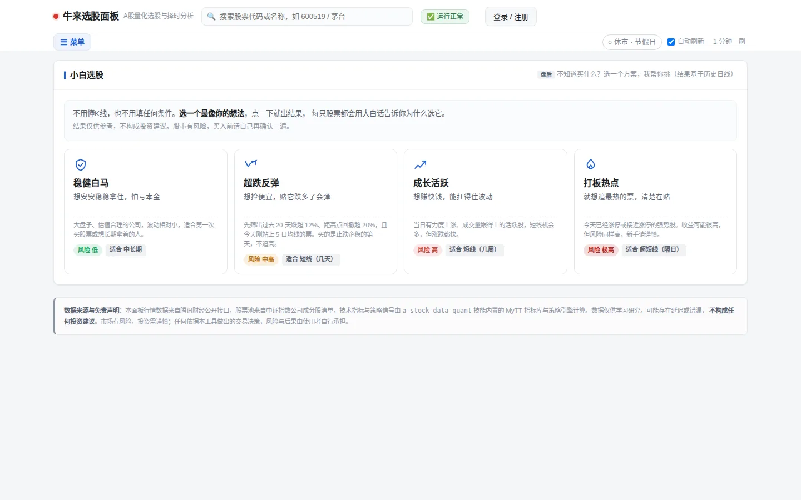</td>
<td width="50%" valign="top"><b>🔍 策略选股</b> —— 29 个策略自由组合<br><sub>按趋势形态 / 量价涨停 / 反转波动 / 形态相似度 / 经典指标 / 分钟级六类组织，点击即选、并集交集、秒级扫全市场</sub><br>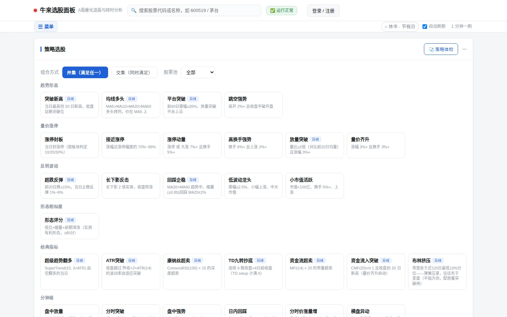</td>
</tr>
<tr>
<td width="50%" valign="top"><b>🎯 条件选股</b> —— 像填表一样选股<br><sub>PE / PB / 市值 / 涨跌幅 / 换手率 / 成交额自由组合，内置「低估值蓝筹」「成长活跃」「小市值活跃」「深度价值」四套预设</sub><br>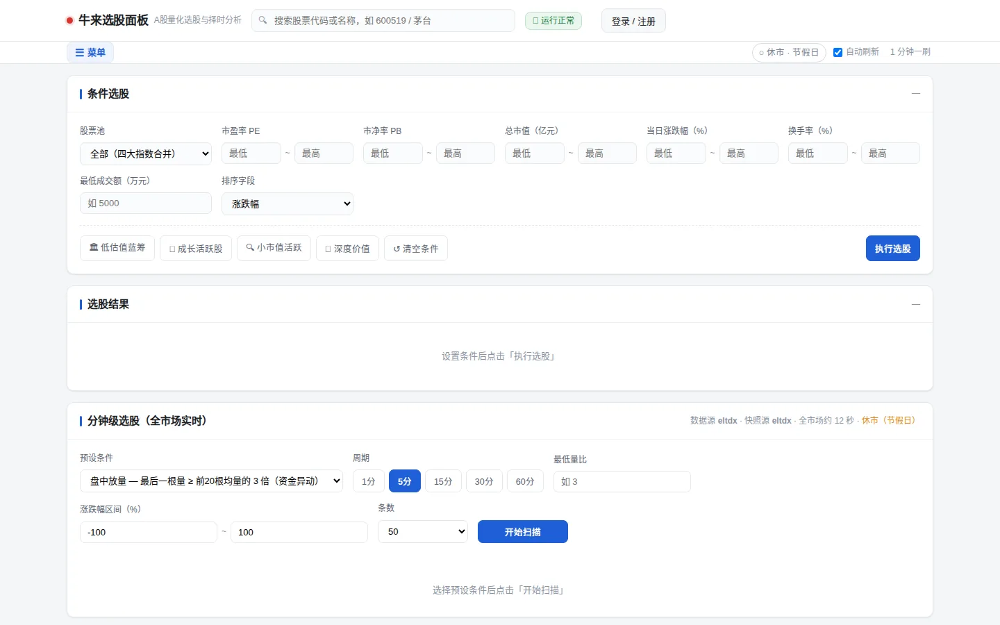</td>
<td width="50%" valign="top"><b>📊 市场榜单</b> —— 六大榜单 + 温度画像<br><sub>涨幅 / 跌幅 / 成交额 / 换手率 / 市值 / 低估值，叠加市场温度 13 维画像与涨跌分布</sub><br></td>
</tr>
<tr>
<td width="50%" valign="top"><b>📰 双源快讯</b> —— 新浪 7×24 + 同花顺<br><sub>双源互备去重，重大消息红条高亮；词典情绪引擎自动打「看涨 / 看跌 / 中性」标签，关联股票可点直达</sub><br>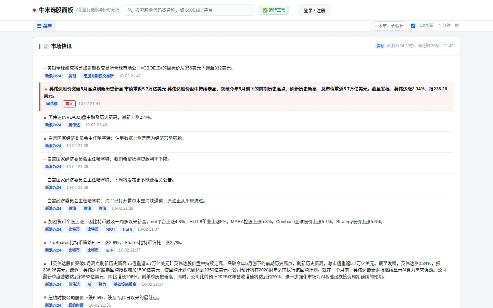</td>
<td width="50%" valign="top"><b>🧪 策略回测</b> —— 真实约束下的成绩单<br><sub>T+1、手续费、印花税、滑点全模拟；支持止损止盈与金字塔加仓；网格回测与走查回测防过拟合</sub><br>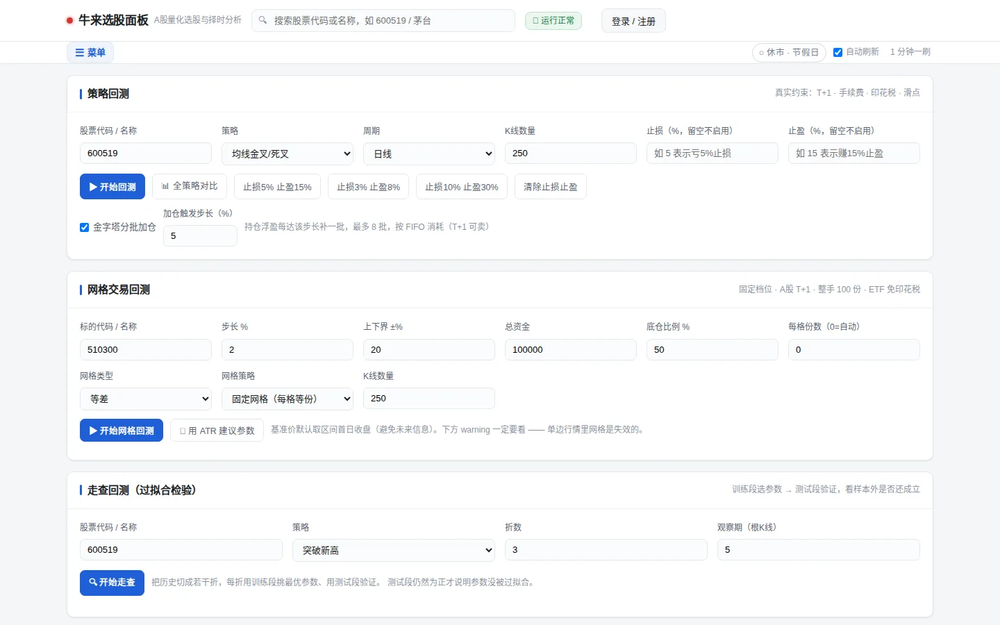</td>
</tr>
<tr>
<td width="50%" valign="top"><b>📈 个股分析</b> —— K 线 + 60+ 项指标<br><sub>日 / 周 / 月 + 1~60 分钟 K 线，四种通道叠加，技术面结论卡片；资金流向 / 筹码分布 / 基本面 / 研报公告</sub><br>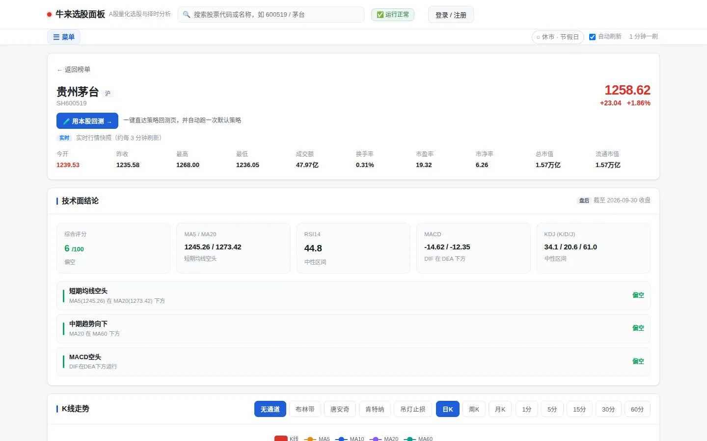</td>
<td width="50%" valign="top"><b>🔥 连板梯队</b> —— 梯队分组 + 情绪周期<br><sub>近 12 日 K 线算连板天数，首板 / 2 板 / 3 板 / 4+ 板分组；融合 6 阶段市场情绪（冰点→启动→主升→高潮→退潮→修复）</sub><br>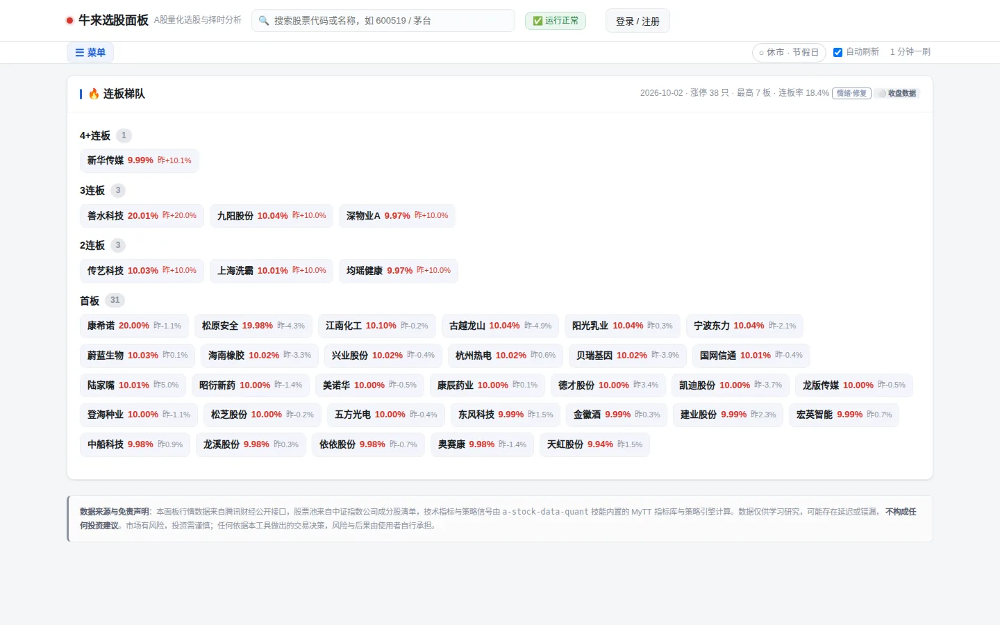</td>
</tr>
<tr>
<td width="50%" valign="top"><b>🎯 题材雷达</b> —— 板块四维评分<br><sub>行业板块融合去重 + 实时主线排行，热点一目了然</sub><br>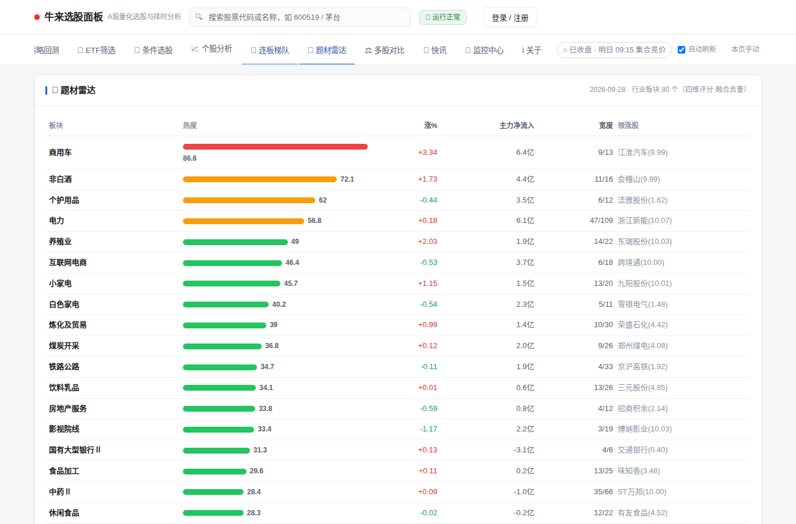</td>
<td width="50%" valign="top"><b>ℹ️ 关于</b> —— 模块构成实时统计<br><sub>指标数 / 策略数由后端实时统计，新增即自动同步；附技术实现、数据源与免责声明</sub><br>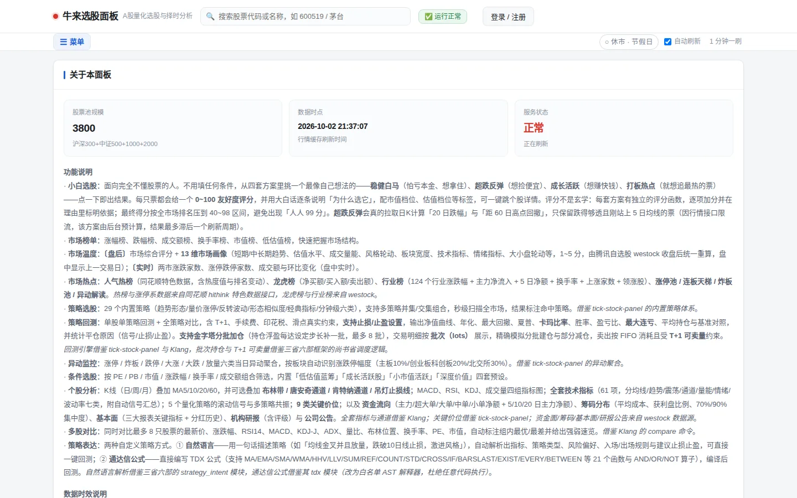</td>
</tr>
<tr>
<td width="50%" valign="top"><b>🐂 牛熊速查 · 白天</b> —— 0~100 温度 + 六档仓位<br><sub>四类加权（估值 / 资金 / 情绪 / 技术）压成一个分数，六段温度条上指针定位当前档位；下方是情绪面六维雷达与温度趋势图，四类明细可展开看 13 维原始分与上游状态文本（如「暴跌(均线空头排列…)」）</sub><br>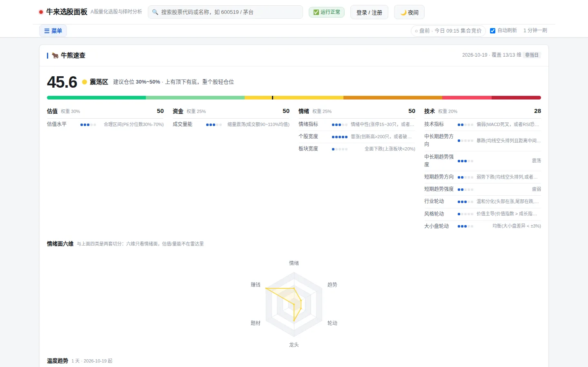</td>
<td width="50%" valign="top"><b>🐂 牛熊速查 · 夜间</b> —— 同一套令牌换肤<br><sub>暗色下语义 tint 改为半透明叠加 + 提亮字，图表文字色随主题一起换；温度色（绿→黄→红）是跨主题恒定的独立令牌，不随涨跌色漂移——否则浅色下「黄档」会变成信息蓝</sub><br>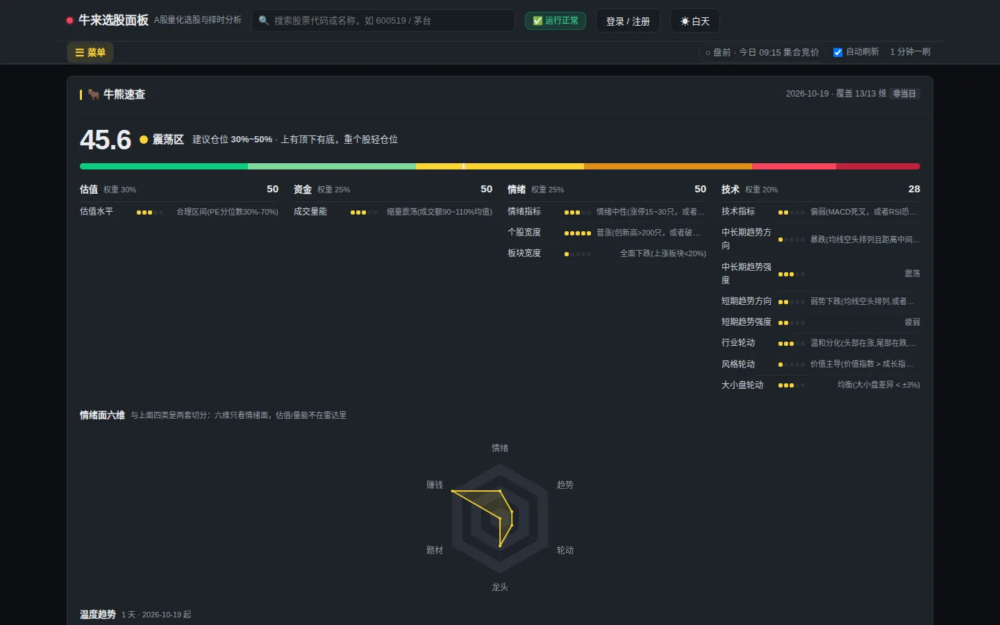</td>
</tr>
<tr>
<td width="50%" valign="top"><b>🧪 因子实验室 · 白天</b> —— 12 因子 IC/ICIR 检验<br><sub>股票池下拉直接标注每个池的「有效截面 N 日」，不够 250 日的置灰不给选；表格给 IC 均值 / ICIR / IC&gt;0 / t 值 / BH 校正 q 值 / 有效率 / 单调性 / 判定，判定要「|ICIR|≥0.3 且 q≤0.1」两个条件同时满足；五档分层收益与市况分段折叠在下，默认收起不打扰</sub><br>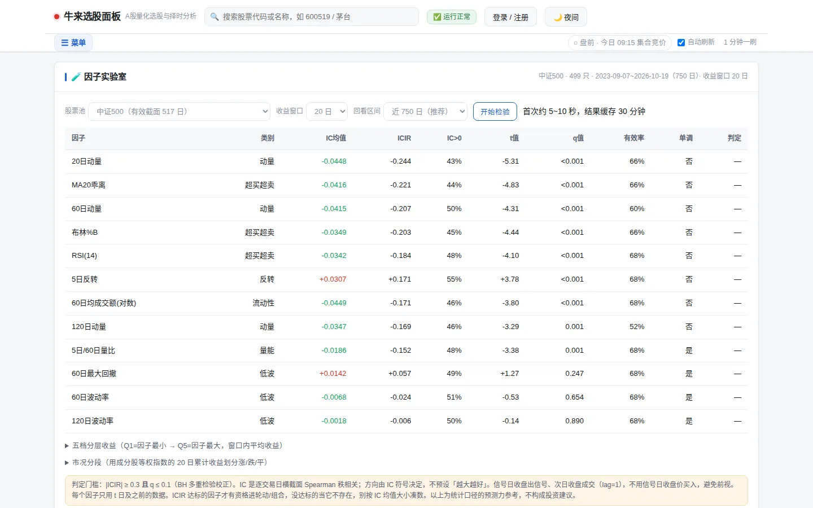</td>
<td width="50%" valign="top"><b>🧪 因子实验室 · 夜间</b> —— 同一套表格换肤<br><sub>分层收益条正负用涨跌色（红正绿负）而非第二套配色；q 值小于 0.001 收敛显示为「&lt;0.001」避免科学计数法；有效率是 0~1 比例，显示统一 ×100（这里曾经踩过「0.658 显示成 1%」的坑）</sub><br>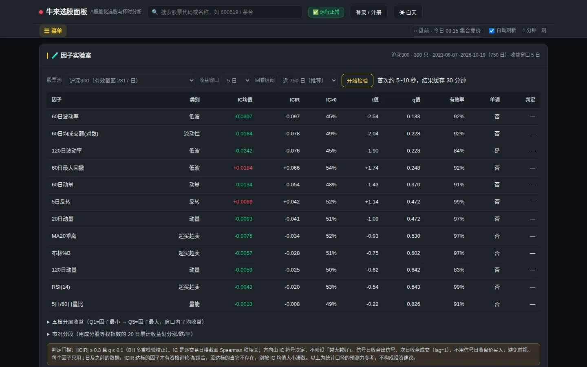</td>
</tr>
<tr>
<td width="50%" valign="top"><b>✨ AI 解读 · 白天</b> —— 检验结果翻译成小白大白话<br><sub>点控制条「✨ AI 解读」：先给一句总览（有没有因子真有预测力、最值得关注谁），再逐因子讲「在算什么 / 能怎么用」，判定未通过的因子会明说「只适合观察」；末尾列使用注意点与今日配额。LLM 不可用时页面照常，只在卡片位置说明原因</sub><br>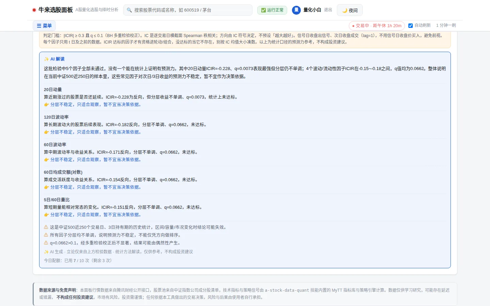</td>
<td width="50%" valign="top"><b>✨ AI 解读 · 夜间</b> —— 同一份解读换肤<br><sub>所有数字来自上方检验结果，LLM 只负责翻译；因子名逐个校验，编一个不存在的名字整份作废；解读缓存 30 分钟内命中不扣配额（标「缓存复用 · 未扣次数」）；与「小白讲解」「AI 深度分析」共用每日配额池</sub><br>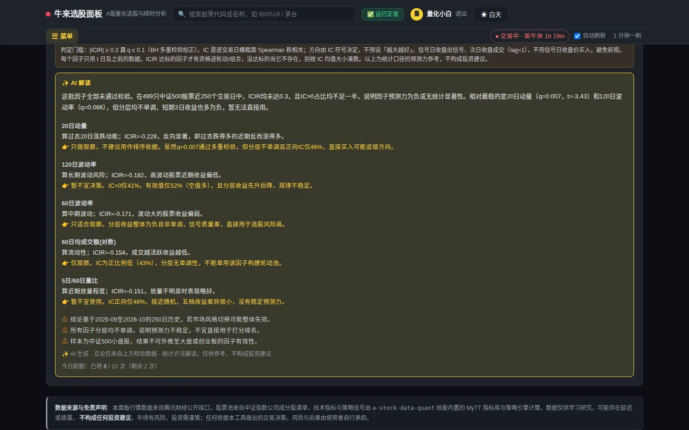</td>
</tr>
<tr>
<td width="50%" valign="top"><b>📈 个股因子画像 · 白天</b> —— 同一把尺子递给每只票<br><sub>个股页直读同一批 12 个因子，给<b>当前值</b>与在本股近 750 日中的<b>历史分位</b>。分位条只表达「位置」不表达好坏——同一个 80% 分位，对低波因子是「波动比历史大」，对动量因子是「涨幅比历史强」。易读反的档位单独措辞：最大回撤分位 79% 显示为「回撤较浅」而非「偏高」，否则会被读成回撤偏大</sub><br>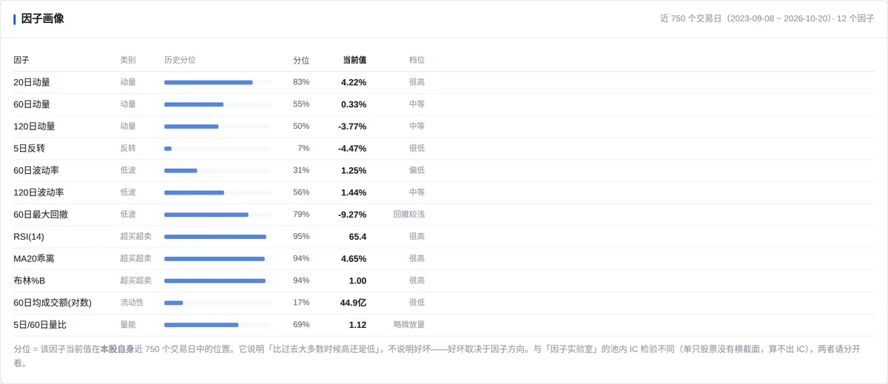</td>
<td width="50%" valign="top"><b>📈 个股因子画像 · 夜间</b> —— 同一套行样式换肤<br><sub>纯本地库计算，不联网、不调模型、<b>不扣配额</b>，单票 0.1~0.3 秒。个股刻意<b>不做 IC</b>：单只票只有一条时间序列，每期 1 个样本，IC 在统计上无定义——硬套只会产出看似专业、实则无意义的数字。样本不足 250 点时显示「样本不足」，不编分位糊弄</sub><br>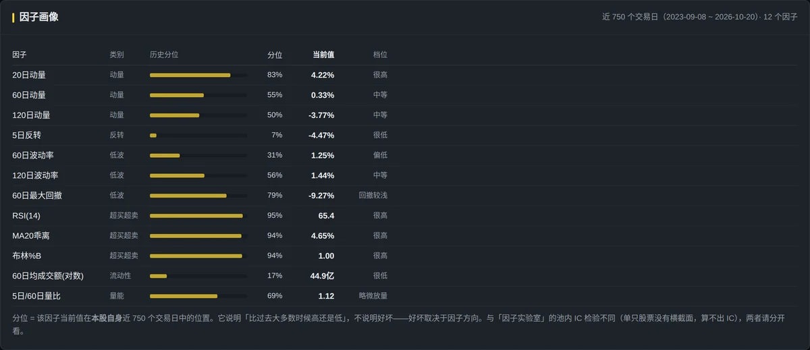</td>
</tr>
<tr>
<td width="50%" valign="top"><b>🌗 白天模式</b> —— 浅色画布（默认）<br><sub>浅色色值取自主题改造前的原始配色，语义芯片回到「浅底 + 深字」，主按钮蓝底白字；红涨绿跌在浅色下同样成立</sub><br>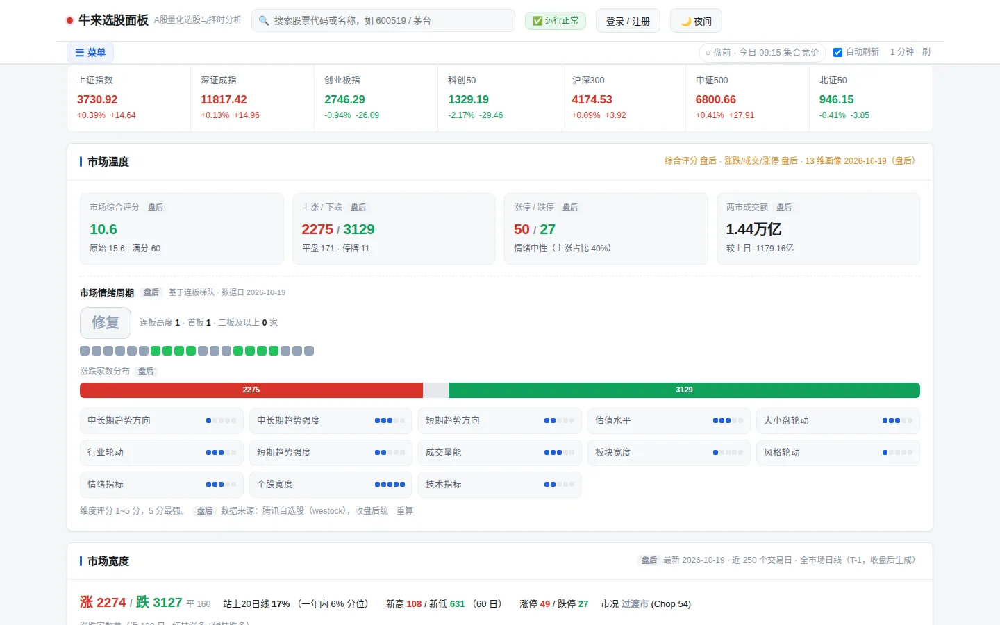</td>
<td width="50%" valign="top"><b>🌗 夜间模式</b> —— Binance 风格暗色<br><sub>近黑画布 + 卡片分层，主强调为「黄底黑字」签名 CTA；切一次即记住，首屏内联脚本避免刷新闪错主题</sub><br>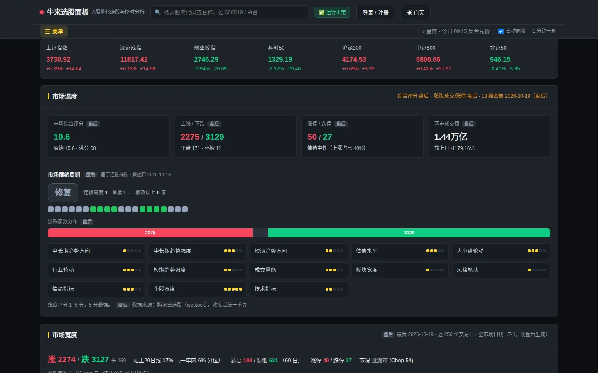</td>
</tr>
<tr>
<td width="50%" valign="top"><b>🏭 板块舆情</b> —— 快讯按板块聚合的多空热度<br><sub>双源快讯近 1/3/6/12/24 小时滚动窗口，按 ticker 反查 + 关键词聚到板块，给出偏多/中性/偏空占比与净情绪；卡片化展示，非实时单条、非预测</sub><br>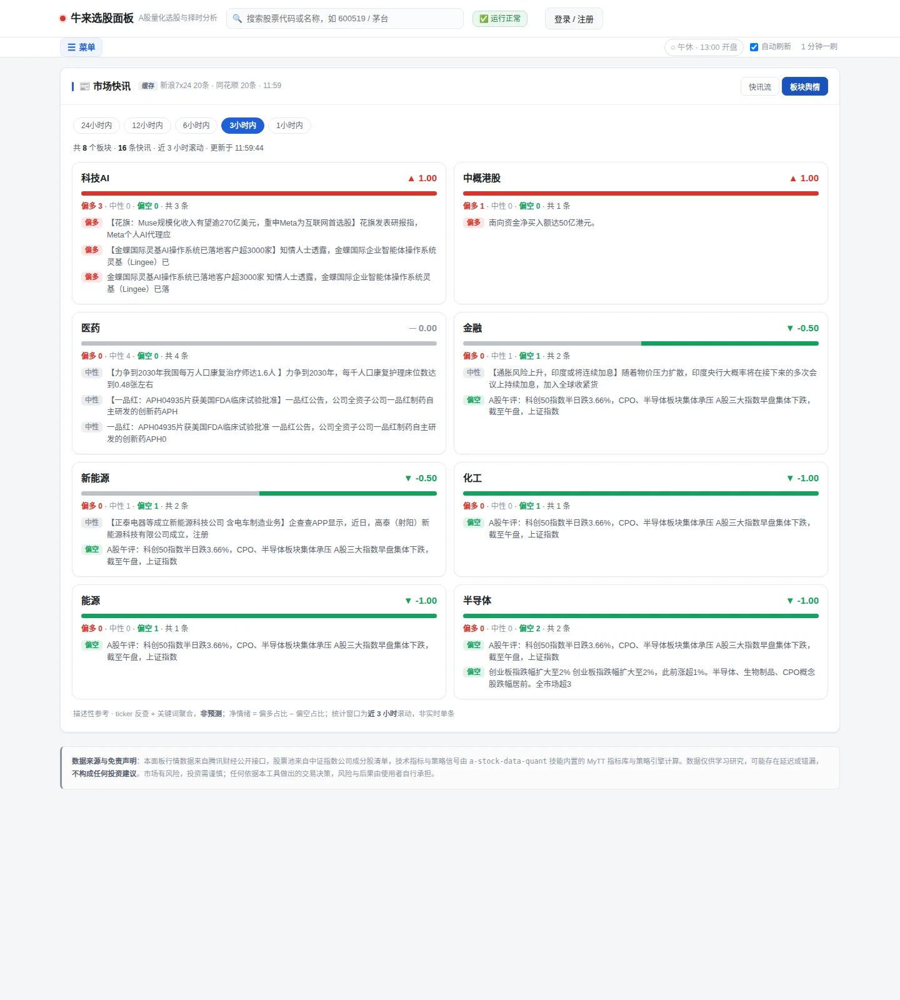</td>
<td width="50%" valign="top"><b>🌐 多源快讯 + 后台 API 密钥</b> —— 自建可自填密钥<br><sub>快讯并联 Finlight（带情绪）/ FreeNews / OkSurf 多源；后台「运行参数」页把 API 密钥设为密码框，自托管用户可在网页后台直接填写，无需改代码</sub><br></td>
</tr>
</table>

---
## 🐂 牛熊速查 + 🌗 昼夜主题（v1.1.0 新增）

### 🐂 牛熊速查：把「市场温度」压成一个能看位置的分数

市场温度散落在 13 个维度里，单看涨停家数或单看指数涨跌都容易以偏概全。这个页面做一件事：**把上游 13 维归并成一个 0~100 分 + 六档仓位建议**，让「现在处在周期的哪个位置」一眼可见。

**分数怎么来的**（不新增任何外部数据源，全部复用面板已有的 13 维）：

| 类别 | 权重 | 支撑维度 |
|---|---|---|
| 估值 | 30% | 估值水平（PE 分位） |
| 资金 | 25% | 成交量能 |
| 情绪 | 25% | 情绪指标、个股宽度、板块宽度 |
| 技术 | 20% | 技术指标、短/中长期趋势方向与强度、行业/风格/大小盘轮动 |

各维原始 1~5 分归一化到 0~100，类内等权、类间加权。

**六档仓位映射**（反直觉，务必先看这句）：

| 分数 | 档位 | 建议仓位 | 信号灯 |
|---|---|---|---|
| 0~20 | 冰点区 | 60~80% | 🟢 |
| 20~40 | 低迷区 | 40~60% | 🟢 |
| 40~60 | 震荡区 | 30~50% | 🟡 |
| 60~80 | 活跃区 | 20~40% | 🟠 |
| 80~90 | 过热区 | 10~20% | 🔴 |
| 90~100 | 疯狂区 | 0~10% | 🔴 |

> **分数越高 = 市场越热 = 建议仓位越低。**「热」不是好事，是风险累积。90 分以上是「人人谈股」的疯狂区，只配 0~10%；20 分以下的冰点区才配到 60~80%。

**页面上有什么**：

- **温度条**：六个分段色块 + 指针，分段边界就是档位切换点（分段而非渐变——那是数据不是装饰）
- **情绪面六维雷达**：情绪 / 赚钱 / 题材 / 龙头 / 轮动 / 趋势，六维全部由现有 13 维支撑（「龙头」= 行业轮动，上游原文即「头部在涨 / 尾部在跌」）。与上面四类是两套切分：六维只看情绪面，估值与量能不在雷达里
- **四类明细**：展开可看每个维度的 5 点刻度与上游状态文本（如「暴跌(均线空头排列…)」「缩量震荡(成交额 90~110% 均值)」）——单看 1~5 的分数没人知道 1 是什么意思，状态文本才是人话
- **温度趋势图**：每天收盘后落一行（默认 16:45，`TICK_BULLBEAR_AT` 可改），攒够 2 天起画趋势线，背景铺六档色带

**几个刻意的设计取舍**（都会在页面上如实标注，不藏着）：

- **资金维目前只有一个维度**（成交量能）。两融余额 / 10Y 国债 ERP / 破净股数都无稳定免费源，北向资金自 2024-08 起交易所已停止实时披露——接了也是半残数据，全部不接，页面标注覆盖率
- **缺失维度做权重再分配**，不做「缺了按 50 分算」：把没取到数伪装成「市场不冷不热」，等于把故障显示成结论。重新分配时会标「权重已重分配」
- **取数失败绝不写 0 分**：0 分=冰点=最强买入暗示，历史序列里绝不能用 0 表达「无数据」
- **历史无法回补**：13 维历史此前从未落库，序列只能从启用当天往后攒，初期会显示「已积累 N 天」而不是画一条假趋势线
- **权重未经本地拟合**：30/25/25/20 沿用外部模板的给定值，没有历史区间数据去证伪它，本地调参只会把主观意见伪装成统计量

> 以上为统计口径的位置参考，**不构成投资建议**。

### 🌗 白天 / 夜间模式

顶栏「☀ 白天 / 🌙 夜间」一键切换，选择存 localStorage，`<head>` 内联脚本在首屏前同步 `data-theme`，刷新不会闪错主题。**默认白天**。

实现走**令牌而不是两套样式**：`:root[data-theme="light"]` 只覆盖 CSS 变量（浅色值取自主题改造前的原始配色），图表里 65 处硬编码色（tooltip 背景 / 轴线 / 网格 / 轴标签 / 图例）全改读 CSS 变量，所以两种模式下图表一起换色，不用维护两份 option。

配套处理的细节：

- `--on-primary` 变量化：暗色黄底黑字、浅色蓝底白字（顺手修了浅色下主按钮蓝底黑字只有 2.5:1 的老问题）
- 语义 tint 自动适配：暗色下半透明叠加 + 提亮字，浅色下回到「浅底 + 深字」
- **温度色是跨主题恒定的独立令牌**（`--bb-cold/mild/warm/hot/over/mad`）——温度语义（绿=冷 → 红=热）不该随涨跌色漂移，否则浅色下「黄档」会变成信息蓝
- 分数等文字用中性色，仪表色只上色块（黄字白底对比度只有 1.6:1）

> 已知简化：切换主题会整体 reload——K 线数据没缓存在 `state` 里（只有分钟模式有），按主题重画需重新取数。要改成只重画不刷新，得先把最近一次响应存进 `state`。

---

## 🧪 因子实验室：IC/ICIR 因子检验（v1.1.0 新增）

这一页回答一个很具体的问题：**哪些指标对 A 股未来收益真有预测力？**

和「策略体检」是两件事，别混：

| | 策略体检（`strategy_eval`） | 因子实验室（`factor_lab`） |
|---|---|---|
| 评估对象 | 0/1 **选股信号**（命中/不命中） | **连续因子**（动量、低波、反转、流动性…） |
| 回答 | 这个策略最近灵不灵 | 这个因子本身有没有 alpha |
| 用途 | 决定要不要开某个策略 | 决定轮动/组合用什么做原料 |

因子是轮动策略的原料：**没有预测力的因子，轮动就只是随机换仓。**

### 检验怎么做的

1. 构造因子矩阵（交易日 × 股票），**只用 t 日及之前的数据**，无前视；
2. 未来收益 `ret[t] = close[t+1+forward] / close[t+1] - 1`——t 日收盘出信号、**t+1 收盘才买入**（贴近实盘，避免「用信号日收盘价成交」的前视）；
3. 每个交易日做一次**横截面 Spearman 秩相关**，得到 IC 序列；
4. 汇总 IC 均值 / ICIR / IC>0 占比 / t 值 / **BH 校正后的 q 值** / 五档分层收益 / 市况分段（用成分股自构等权指数划分涨 / 跌 / 平，不依赖外部指数数据）。

内置 12 个因子，方向**不预设**「越大越好」，由 IC 符号定：

| 类别 | 因子 |
|---|---|
| 动量 | 20 / 60 / 120 日动量 |
| 反转 | 5 日反转 |
| 低波 | 60 / 120 日波动率、60 日最大回撤 |
| 超买超卖 | RSI(14)、MA20 乖离、布林 %B |
| 流动性 | 60 日均成交额（对数） |
| 量能 | 5 日 / 60 日量比 |

### 两个刻意设计，别在后续迭代里改掉

**① 判定是「|ICIR| ≥ 0.3 且 q ≤ 0.1」，不是只看 ICIR。**

一次跑 12 个因子，就算全部无效，按 `p<0.05` 平均也会捞出 0.6 个「显著」——这就是多重检验。ICIR 单看分不清「真有 alpha」和「运气好」，所以加了 Benjamini-Hochberg FDR 校正：q 值把「同时检验了 N 个」这件事折进去。**只满足 ICIR 不满足 q 的因子，判定列不给 ✅。**

**② 数据不够就直接拒绝跑，不硬产出结果。**

池内有效截面不足 **250 个交易日（约一年）**时，后端返回 409 并说明原因。原因是 ICIR 这类指标在样本不足时会给出一个**看起来很正常的数字**，用户没法从结果本身判断它是不是噪声；而在入口处明说「不够」，至少知道该去补数据而不是信一个假信号。宁可拒绝，不可糊弄。

> 实测口径（2026-10-19 库内数据）：沪深300 有效截面 2817 日、中证500 517 日、中证1000 2971 日、中证2000 524 日——四个池都够跑；「全部（四大指数合并）」在池下拉里是置灰的，因子库只支持单一指数池。

### 性能与缓存

- 默认只取**近 750 个交易日（约 3 年）**：全历史 3106 天跑 12 个因子的 IC 要几十秒，而几年前的 IC 对当下几乎没有参考价值。可在「回看区间」里改 250 / 1500 / 全部历史；
- 结果按 `(池, 收益窗口, 回看区间, 是否分段)` 缓存 **30 分钟**，二次打开从 5.5 秒降到 0.07 秒；
- 首次进入页面只读股票池覆盖情况（`<1s` 的轻量查询），**点「开始检验」才开始跑重的**；
- 改任何参数自动重跑（缓存 key 含这三个参数，不会拿到旧结果）。

### 一键 AI 解读（给小白的大白话）

检验表格对小白不友好——ICIR、q 值、分层单调性，每个词都得查一遍。控制条上的「✨ AI 解读」把当前这份检验结果发给大模型，翻译成三样东西：

- **总览**：这批因子整体有没有预测力，最值得关注的一两个是谁（引用给定数字）；
- **逐因子**：这个因子在算什么、算出来的数说明什么、能怎么用（如「可作轮动池的排序依据」）；判定未通过的因子会明说「只适合观察、暂不宜当决策依据」；
- **注意点**：使用前必须知道的事（样本期多长、市况变了可能失效、分层不单调意味着预测力不稳定）。

四个刻意设计，别在后续迭代里改掉：

1. **只喂前 5 个因子，且名字写进 prompt 逐个校验。** 后端先按 |ICIR| 降序取前 5 名，返回的因子名不在这份名单里，整份解读作废。少了这道，LLM 会自己挑因子、甚至编一个不存在的名字——而用户看不出区别；
2. **所有数字必须来自传入的检验结果。** LLM 的活是「翻译 + 解释怎么用」，不是「算数」。检验结果是确定性算出来的，不能反过来被 LLM 改写；
3. **解读缓存命中不扣配额。** 同一份检验结果 30 分钟内的解读直接复用（标「缓存复用 · 未扣次数」），不重复花 Token；顺序上是先查缓存、再扣次数；
4. **失败绝不伪装成成功。** LLM 未启用 / 网络错 / 输出不过 schema，一律 `llm=null` + 原因文案，页面照常可用（脚注口径常驻），不报错、不白扣配额。

与「小白选股 AI 讲解」「AI 深度分析」共用同一配额池（默认 10 次/天，后台「AI 用量」面板可调），模块开关 `TICK_AUTH_REQ_FACTORAI` 默认要求登录。

### 个股页面：因子画像（不做 IC）

个股页也有一块「因子画像」卡片，但**它和上面这张 IC/ICIR 表不是同一件事**，两者不可互相替代：

| | 因子实验室（池级） | 个股因子画像 |
|---|---|---|
| 算法 | 横截面 **IC / ICIR** | 单序列**历史分位** |
| 回答 | 按这因子排序，能不能选出更好的一批 | 这只票现在的因子值，相对它**自己的历史**什么水平 |
| 样本 | 池内数百只股票的每日截面 | 该股近 750 个交易日 |
| 联网 / LLM | 本地库 + 可选 AI 解读 | 纯本地库，不联网、不调 LLM、不扣配额 |

**为什么个股不做 IC**：IC 是横截面统计量（同日池内排名 vs 未来收益排名的相关性）。单只股票只有一条时间序列，每期 1 个样本，IC 在统计上**无定义**——不是「算出来很差」，而是根本算不出来。硬套只会产出一个看似专业、实则无意义的数字，所以这里刻意只做分位。

实现要点（`server/factor_single.py`）：

- **完全复用 `factor_lab.build_factors`**：那批 `_f_*` 函数都是按列运算，N=1 的矩阵照常工作，口径与因子实验室严格一致（两处数字打架是最难查的 bug）；
- **分位口径是「严格小于的比例 + 平局折半」**，所以最小值落在 0 而非 `1/N`；重复值多时（RSI、成交额对数常见）不会把分位系统性抬高；
- **方向易读反的因子单独措辞**：`mdd_60` 是负值，分位 79% 的含义是「回撤比历史上 79% 的时候**更浅**」，直接标「偏高」会被读成「回撤偏大」，故覆盖为「回撤较浅 / 回撤很深」；`vol_surge` 同理改为「显著放量 / 缩量明显」；
- **样本不足就明说**：有效历史少于 250 点时 `pct=null`，显示「样本不足」，不编一个分位糊弄；
- **当前值取最后一个有效点**：停牌 / 新股末格为空时，取 `[-1]` 会让整个因子莫名空缺。

接口 `GET /api/stock/factors?code=sh600519`，单票约 0.1~0.3s（纯内存计算），同步返回即可，不需要「提交 + 轮询」；结果按代码缓存 10 分钟。

> 档位是**位置描述**，不是好坏判断——同一个 80% 分位，对低波因子是「波动比历史大」，对动量因子是「涨幅比历史强」，好坏取决于因子方向。

<sub>📸 效果见上方「页面预览」中的「个股因子画像 · 白天 / 夜间」两图。</sub>

**窄屏怎么排**：卡片在手机上是两行——首行「因子名 · 当前值 · 档位」，次行「分位条 · 分位百分比」。之所以不沿用一行到底，是因为固定列宽合计超过 380px，窄屏下会把「当前值」「档位」两列整个挤出屏幕，而这两列恰恰是最该看的。名称列宽按最长因子名「60日均成交额(对数)」实测定为 140px，再窄就会截断。

### 已知边界（如实说明）

- 因子是 12 个**内置**连续因子，暂**不支持**用户自定义公式因子与复合因子（需要一套安全的表达式求值器，是另一件事）；
- 暂无 PIT（Point-In-Time）财务因子，也暂无「自动挖掘 + 组合搜索 + 嵌套样本外验证」的调度器——那需要先有足量历史，且与已有的策略回测 / 多策略组合回测 / `walkforward_lab` 有重叠，等真实需求再补；
- 因子的预测力会随市况衰减，本页给的是**统计口径的历史预测力**，不是未来收益承诺。

> 以上为统计口径的因子预测力参考，不构成投资建议。

---

## 🧪 选股复盘闭环（#103~#105 新增）

这一组功能解决一个老问题：**选完股就扔了，好不好用、涨没涨，全凭记性。** 现在每次在【小白选股】【策略选股】【条件选股】跑完，结果都会**自动存档**到「📜 历史选股」页面，事后可回看胜率、算清收益、批量沉淀到自选。

<table>
<tr>
<td width="50%" valign="top"><b>🧭 分组导航</b> —— 17 个入口不再平铺<br><sub>按「📊 看盘 / 🔍 选股 / 📈 分析 / ⭐ 我的」4 组归位，点左上角「☰ 菜单」展开抽屉（桌面 / 手机一致），顶部指标卡不受影响</sub><br>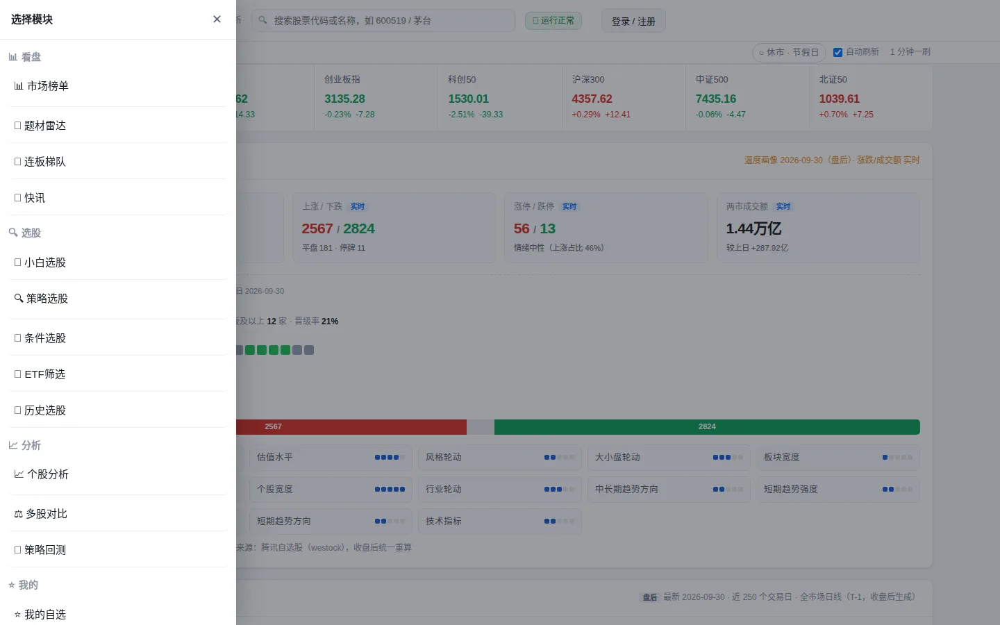</td>
<td width="50%" valign="top"><b>📜 历史选股</b> —— 每次选股自动存档<br><sub>三个选股页每执行一次自动落库一条（含条件与个股列表）；顶部按「全部 / 小白 / 策略 / 条件」筛选；标题中文化、按账户隔离，只看到自己的记录</sub><br>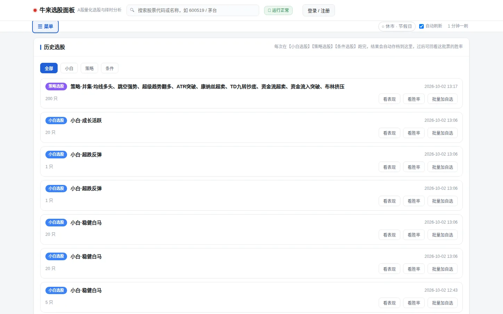</td>
</tr>
<tr>
<td width="50%" valign="top"><b>🎯 看胜率</b> —— 这套策略到底灵不灵<br><sub>对入选股模拟「次日 09:30–09:50 VWAP 买入、当天收盘卖出」，给出涨停率 / 胜率 / 平均涨幅 / 累计盈亏（每只 1 万元本金折算）；弹窗内可调整金额与回看天数</sub><br>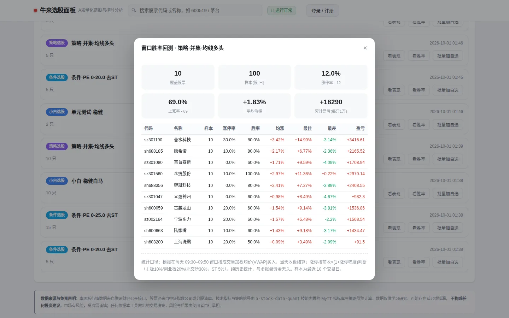</td>
<td width="50%" valign="top"><b>📈 看表现</b> —— 选完到现在涨了还是跌了<br><sub>以入选价（缺失时取入选日收盘兜底）对比最新价：平均涨跌幅 / 上涨胜率 / 最佳最差 / 累计盈亏，逐只列出入选价 / 最新价 / 涨跌幅</sub><br>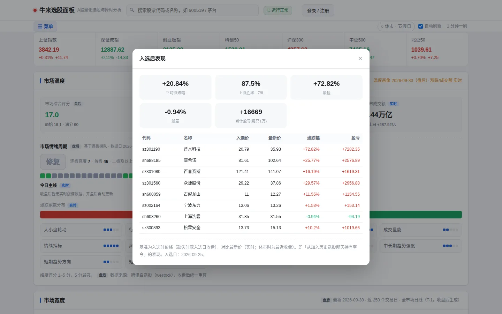</td>
</tr>
<tr>
<td width="50%" valign="top"><b>⭐ 批量加自选</b> —— 一键沉淀带分组<br><sub>弹窗里选已有分组或输入新分组名（留空不新建），整批按代码加入、已存在自动跳过；配合自选分组按策略 / 行业 / 观察池整理</sub><br>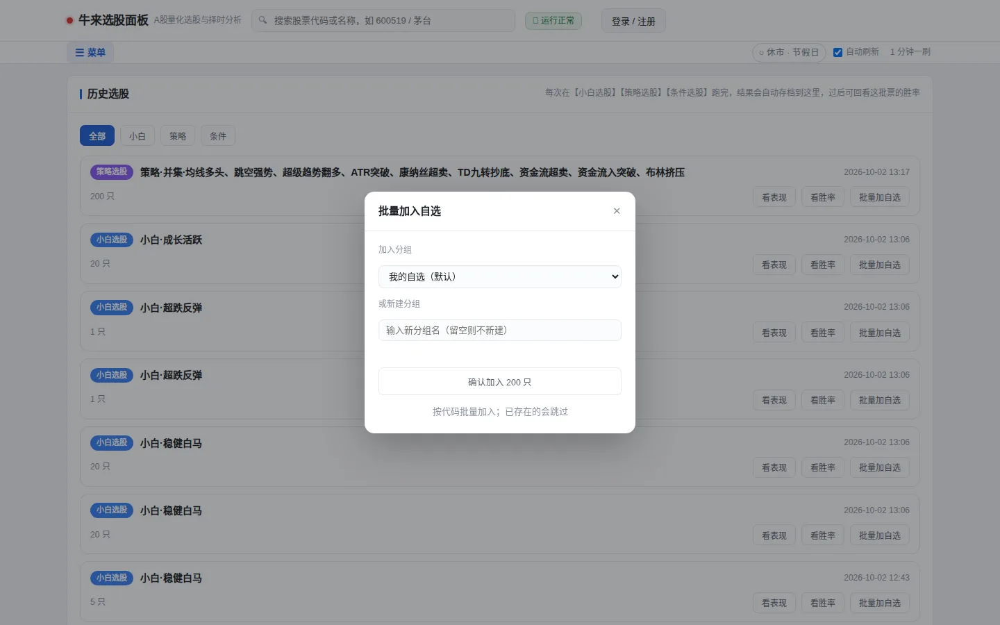</td>
<td width="50%" valign="top"><b>☑️ 批量操作栏</b> —— 结果页直接勾选<br><sub>三选股页结果表每行复选框 + 表头批量栏：全选、已选 N 只计数、看胜率、加自选；不勾选默认对当前全部结果操作</sub><br>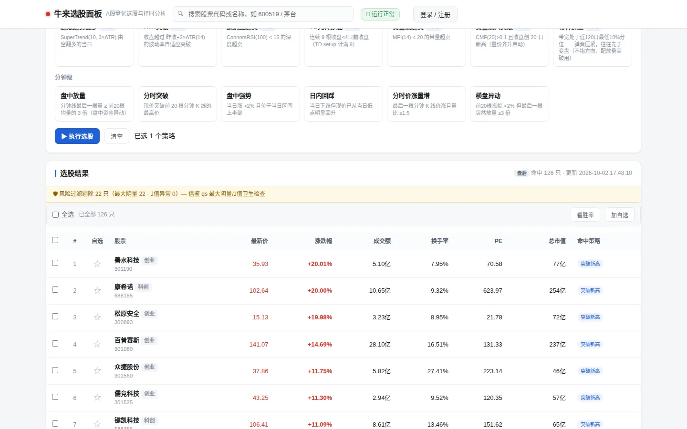</td>
</tr>
</table>

> 📌 **口径与细节**：胜率回测买入价 = 09:30–09:50 分钟成交额 ÷ 成交量（真实 VWAP）；涨停按前收 ×(1+涨停幅度)（主板 10% / 创业板·科创 20% / 北交所 30%，ST 5%）；回测为纯历史统计，与虚拟盘资金完全隔离。看表现基准为入选时价格，**休市日入选因无新价格涨跌显示 0，属正常**。

### 📅 本地交易日历（#104）

内置 A 股节假日表（2026 年依据国办明电，2027 年为预测值），**休市 / 补班自动识别**。影响两处：顶栏交易时段时钟显示「休市 · 节假日」；**连板天数、选股、胜率回测按交易日对齐**，不会把周末误算成交易日。

> 周末一律休市，不看调休补班表——补班是给「上班」用的，不是给「A股开盘」用的。

### 🌅 盘前竞价 + 估值五口径 + 权威日历对账（#106~#108 新增）

这一组走的是同花顺（hithink-finance）公开 API，**属于选填增强**：不配 Key 也能正常跑，只是这三项静默隐藏。

<table>
<tr>
<td width="50%" valign="top"><b>🌅 盘前竞价（#106）</b><br><sub>竞价时段展示「我的自选 · 集合竞价」：涨幅 / 量比 / 占昨量，未匹配个股单独标出；下半屏是「短线风向标 · 竞价基准」全市场竞价涨跌幅 + 概念归因标签（如「住宅开发」「租售同权」）。休市日自动回落到上一交易日终态，并在卡片上明确标注「休市 · 展示 YYYY-MM-DD 竞价终态」，不会让你误以为是今天的实时数据</sub></td>
<td width="50%" valign="top"><b>💎 估值五口径（#108）</b><br><sub>个股页头部并排展示 PE(TTM) / PE(MRQ) / PB(MRQ) / PS(TTM) / PCF(TTM)。TTM 是滚动 12 个月、MRQ 是最近一季——两个 PE 背离往往说明盈利正在变化，只看单一 PE 容易误判。ETF 与指数不适用，自动跳过不显示</sub></td>
</tr>
<tr>
<td width="50%" valign="top"><b>🗓 权威日历对账（#107）</b><br><sub>拿同花顺返回的近一年权威交易日序列（实测 241 条）与本地节假日表逐日对账，窗口内有任何一天判定不一致就在自检里报警并列出差异日期。这套对账真的抓到过 bug：本地曾把 5 个「周末补班日」误判成交易日，会让虚拟盘按上周五收盘价成交</sub></td>
<td width="50%" valign="top"><b>🔁 行情多源互备（备源加固）</b><br><sub>快照降级链 <code>eltdx → 腾讯 → 同花顺</code>，日线降级链 <code>腾讯 → 新浪 → 同花顺</code>（同花顺仅支持日线）。实测茅台 250 个交易日收盘价与本地主源<b>偏差 0.0000%</b>（同为前复权口径），可安全当兜底，不会在主源故障时让回测结果漂移。坏代码会被逐只重试隔离，不会拖垮整批请求</sub></td>
</tr>
</table>

> 📌 **三道降级装甲**：① 无 Key 立即返回、不排队；② 全部网络调用包在 try 里，失败只影响这一项；③ 结果缓存 6 小时，对账一天最多跑一次。所以即使同花顺挂了或没配 Key，这三项也只是不显示，**不会拖慢也不会搞崩面板**。

### 🛡️ 虚拟盘收盘禁交易（#103）

虚拟盘的买卖现在受**交易时段守卫**约束：仅在**连续竞价 + 集合竞价**时段允许下单，**收盘 / 休市后自动拒绝**（返回明确提示）。防止误在非交易时间操作。

---
## 🚀 5 分钟跑起来

> 💡 不想动手装？先玩 [**在线体验版**](https://ab1dde4ffb5e275c5.app.workbuddy.host/)，效果满意再回来自建。

### 方式 A：Python 本机（推荐给开发者）

```bash
# Gitee（主仓库，国内更快）
git clone https://gitee.com/jangviktor/niucap.git
# 或 GitHub（双端同步；仓库名 NiuCap，指定目录名保持一致）
git clone https://github.com/jangviktor-web/NiuCap.git niucap
cd niucap
python -m venv .venv && source .venv/bin/activate   # Windows: .venv\Scripts\activate
pip install -r requirements.txt
python server/run.py          # 或 ./deploy.sh（后台常驻 + 可选 Cloudflare 隧道）
# 打开 http://localhost:8899
```

> 需要 Python ≥ 3.11。无需任何 API Key，纯免费公开行情源（腾讯 / 新浪 / 同花顺 / 东财）。

### 方式 B：WorkBuddy 一键发布到云平台（推荐零运维）

本项目已满足云发布要求，在 WorkBuddy 里对仓库说「发布为应用」即可生成可访问的分享链接，无需自己买服务器。完整步骤见下方 **[📘 部署教程](#-部署教程一键发布到-workbuddy-云平台)**。

### 方式 C：Docker 自托管（数据常驻）

仓库未内置 Dockerfile；如需容器化，按 `server/run.py` 暴露的 `8899` 端口自行封装即可，数据卷挂到 `./data`。

---

## 💡 快速上手示例

**① 纯小白，只想看「现在哪些票值得关注」**

打开「🌟 小白选股」→ 选「稳健白马」或「打板热点」→ 一键出结果，每只票附 0~100 友好度评分与大白话理由。

**② 看盘中情绪：连板梯队 + 题材雷达**

打开「🔥 连板梯队」看最高板高度与连板率；再开「🎯 题材雷达」看当日最强主线。标题栏徽标会标明数据是 **盘中实时** 还是 **收盘数据**。

**③ 用命令行 / 程序直接取数（FastAPI 后端）**

```bash
# 连板梯队 + 情绪周期
curl "http://localhost:8899/api/limitup?limit=200"

# 题材雷达（评分降序、融合去重）
curl "http://localhost:8899/api/theme?limit=40"
```

返回示例（节选）：

```json
{
  "date": "2026-09-28",
  "涨停": [ { "name": "新华传媒", "code": "600825", "change_pct": 10.04, "board_days": 2 } ],
  "ladder": { "首板": 17, "2连板": 2, "3连板": 2, "4+连板": 1 },
  "rate": 0.227,
  "max_height": 5,
  "phase": "ignite"
}
```

**④ 键盘流：`Cmd/Ctrl + K`** 呼出命令面板，输入股票代码或模块名直达，无需鼠标点导航。

---

## 🧱 技术栈

| 层 | 技术 | 说明 |
|---|---|---|
| 后端 | Python 3.11 · FastAPI · uvicorn | 异步 API，单端口服务，读 `$PORT` 自适应云平台 |
| 数据 | pandas · numpy | 向量化选股 / 回测计算 |
| 存储 | SQLite（默认） / MySQL 协议库（云端常驻） | `store.py` 自适应切换 |
| 前端 | 原生 HTML / CSS / JS · ECharts | 单页应用，**零构建步骤**，开箱即用 |
| 行情源 | 腾讯 / 新浪 / 同花顺 / 东财 公开接口 | 快照与日线**多源互备**：`eltdx` → 腾讯 → 新浪 → 同花顺，前面的源全挂时自动降级 |
| 设计系统 | `DESIGN.md`（含机器可读 frontmatter）+ CSS 变量令牌 | 颜色 / 字号 / 圆角 / 字体栈集中声明；改主题只改令牌，不写两套样式 |
| 设计体检 | [impeccable](https://github.com/pbakaus/impeccable) 59 条确定性规则 | 免 LLM、免 API key，跑 `impeccable detect --json web/index.html` 输出低对比度 / 过小字号 / 配色漂移 / 装饰性动画等问题；面板已按检测结果把 145 条发现修到 1 条（中文注释里的破折号属误报） |
| 部署 | 本机 · WorkBuddy 云 · Docker | 一条命令起 |

---

## 📘 部署教程：一键发布到 WorkBuddy 云平台

本面板无需自己买服务器，直接在 WorkBuddy 里一键发布为在线应用，生成形如 `https://ab1dde4ffb5e275c5.app.workbuddy.host/` 的分享链接——把链接发给朋友，浏览器打开即用。当前线上示例（已验证可达，HTTP 200）即这一流程的产物。

### 为什么能直接发布

项目已满足 WorkBuddy 云平台的发布要求，发布脚本（`publish.js`）可自动完成「探测运行时 → 装依赖 → 起服务 → 就绪校验 → 出链接」：

| 平台要求 | 本项目实际情况 |
|---|---|
| 单 HTTP 端口 | `server/run.py` 用 FastAPI + uvicorn 起单端口服务 |
| 读取 `$PORT` | `resolve_port()` 优先读 `os.environ["PORT"]`，默认 `8899` |
| 绑定 `0.0.0.0` | uvicorn `host="0.0.0.0"`，网关可访问 |
| 健康检查 | `GET /api/health` 供就绪探测 |
| 声明依赖 | `requirements.txt`（轻量，无 akshare / mootdx） |

### 发布步骤

1. **打开项目**：在 WorkBuddy 中打开本仓库（已 `git clone` 或导入 `niucap`）。
2. **发起发布**：对助手说「发布为应用」或「publish」。助手会执行发布脚本，等价于：
   ```bash
   node <skill-dir>/scripts/publish.js \
     --dir /workspace/tick-stock-panel \
     --language python \
     --install-cmd "pip install -r requirements.txt" \
     --start-cmd "python server/run.py"
   ```
   > 脚本会注入 `PORT` 环境变量，`server/run.py` 自动监听该端口；`--start-cmd` 不写死端口，交给 `$PORT`。
3. **拿到链接**：脚本输出 JSON，形如
   ```json
   { "shareLink": "https://ab1dde4ffb5e275c5.app.workbuddy.host/", "verified": true }
   ```
   把 `shareLink` **整条**（若带 `?sharecode=...` 也要一并保留）发给对方。**不要删掉 `?sharecode=`**——它是访问凭据，缺了对方打开会看到「链接不完整」。
4. **访问**：浏览器打开链接，页面即「牛来选股面板」。首次打开是空库，数据初始化见下方说明。

### 重复发布 / 更新线上

- **同一项目重复发布，保持同一链接**——链接背后的内容会被覆盖，且对所有已拿到链接的人立即生效。
- 本地改完代码后，再对助手说「发布为应用」即可把新版本同步上线；建议先在本地预览确认，避免直接覆盖别人正在看的页面。
- 若 `verified` 为 `false`，稍等几秒再刷新链接（平台就绪有短暂延迟）。

### 下线

对助手说「取消发布 / 下线 / unpublish」，脚本会取消发布并使分享链接失效（破坏性操作，需你明确授权）。

### 云平台注意事项

- **数据临时**：云实例存储通常是临时的，重启 / 重新发布会清空本地 SQLite，需重新同步一次（后台管理 → 运行参数 → 开始同步）。
- 想要**数据常驻、多人共享**，用下方「首次部署必读」的云端 MySQL 协议库方案（填 `TICK_DB_HOST` 等，重启不丢数据）。
- 无需任何 API Key，行情来自腾讯 / 新浪 / 同花顺 / 东财公开接口。

---

## ⚠️ 首次部署必读：数据初始化

为控制仓库体积，**行情数据库（约 270 万行日线）不进 Git**。首次启动服务会**自动建一个空库**——此时页面能打开，但选股 / K 线 / 榜单是空的。两种灌数据方式：

- **本地 SQLite（最简单）**：进入「后台管理 → 运行参数 → 开始同步」，全市场日线约十几秒（走 eltdx 批量源）补齐。
  - 注意：云平台存储通常是临时的，重启会清空，需重新同步一次。
- **云端 MySQL 协议库（数据常驻、多人共享）**：复制 `.env.example` 为 `.env`，填好 `TICK_DB_HOST` 等 6 个变量指向你的 TiDB Cloud / MySQL，重启即自动切换。重启不丢数据，朋友也能直接访问。

---

## ⚙️ 配置（`.env`，可选）

复制 `.env.example` 为 `.env` 按需填写：

- **数据库**：`TICK_DB_HOST` 等 —— 留空用本地 SQLite，填了切云端 MySQL 协议库。
- **每日自动同步**：`TICK_SYNC_BARS_AUTO=1` + `TICK_SYNC_BARS_AT=15:30` + `TICK_SYNC_BARS_COUNT=250` + `TICK_SYNC_BARS_SCOPE=all`。
  - 内置**同步守门三重判断**：工作日 15:00 前不跑全量 / 当日已同步标记 / 抽检覆盖率 ≥90% 跳过，避免重复劳动与误触发。
- **虚拟盘费率**：`TICK_FEE_RATE` / `TICK_STAMP_RATE` 等（仅新用户开户默认值）。
- **舆情巡检时间**：`TICK_SECTOR_AUDIT_AT=21:00` —— 板块舆情规则每日自动巡检的触发时刻（默认 21:00，脏值回落默认）。
- **舆情对账时间**：`TICK_SECTOR_VERIFY_AT=15:30` —— 板块舆情收盘对账的触发时刻（默认交易日 15:30；非交易日不跑，脏值回落默认）。
- **全球信号**：`TICK_GLOBAL_SIGNAL_AT=09:15` + `TICK_GLOBAL_SIGNAL_AT_PM=12:45` + `TICK_GLOBAL_SIGNAL_AI=1` —— 海外源**交易日抓两次**：早盘 09:15（集合竞价开始，抓完约 85s，赶在 09:30 开盘前备好隔夜摘要）+ 午间 12:45（下午开盘前 15 分钟，补覆盖上午才出的消息）。周末与法定节假日不抓。AI 开关：关掉则只抓取展示原文，零 Token 成本；AI 开时额外产出每条要点的利好/利空方向，约 +27% Token。
- **AI 模型（可选）**：`LLM_ENABLED=true` + `LLM_BASE_URL` / `LLM_API_KEY` / `LLM_MODEL` —— 配好后启用策略解析 AI 增强与个股 AI 深度分析（后台「AI 模型」面板可测连通性）；**不配置则全部自动降级**为规则版解析 / 纯数据摘要。
  - `LLM_DISABLE_THINKING=true`（默认开）—— 关闭推理模型的「思考」步骤。`Agents-A1` 这类思考型模型会把推理过程塞进 `reasoning_content`、真正答案在 `content`，思考还会吃掉 `max_tokens` 预算导致接口超时或返回空（表现为所有 AI 功能降级成纯数据摘要）。打开后请求体附带 `chat_template_kwargs.enable_thinking=false`，让模型直接出答案，调用从分钟级降到秒级。切换到非推理模型且希望保留思考时设 `false`。
- **管理员**：`TICK_ADMIN_USERS=用户名1,用户名2` —— 显式配置后仅名单内用户为管理员；**不设则内置默认管理员账号 `admin`**（见下）。

> `.env` 含数据库密码，**已被 `.gitignore` 排除，切勿提交**。

---

## 🔐 默认管理员账号

**只要 `admin` 在管理员名单内（未配置 `TICK_ADMIN_USERS` 时默认在内，或你显式把它列入），且 `admin` 账号尚不存在，服务首次启动就会自动创建该账号**，开箱即可进后台：

| 项目 | 值 |
|---|---|
| 用户名 | `admin` |
| 密码 | `123456` |

```bash
# 登录后建议立刻改密（后台管理 → 用户 → 重置密码），或显式接管管理员：
TICK_ADMIN_USERS=你的用户名
```

> ⚠️ **安全警告**：`123456` 是极弱默认密码。只要把面板暴露到公网，**任何人都能用 admin/123456 登入后台**。请务必在首次登录后立即修改密码，或用 `TICK_ADMIN_USERS` 指定你自己的管理员用户名（指定后内置默认 admin 即失效）。该账号仅用于「开箱即用」，不应长期保留默认密码。

---

## 🔒 登录要求：哪些功能需要账号（后台可逐项开关）

> **默认值全部「要求登录」，但每一项管理员都能在后台改** —— 见下方「后台配置」。

| 类别 | 是否要登录（默认） | 涉及接口 | 后台开关 |
|---|---|---|---|
| 🎯 条件选股（含高级条件筛选） | **必须登录** | `/api/screener`、`/api/screen/fields` | `TICK_AUTH_REQ_SCREEN` |
| 🌟 一键选股（小白策略） | **必须登录** | `/api/newbie_pick` | `TICK_AUTH_REQ_NEWBIE` |
| 💬 一句话选股 | **必须登录** | `/api/intent_parse` | `TICK_AUTH_REQ_NLPICK` |
| 🔍 策略选股 | **必须登录** | `/api/strategy_scan` | `TICK_AUTH_REQ_STRATEGY` |
| ⏱ 盘中扫描（分钟级全市场） | **必须登录** | `/api/intraday_scan` | `TICK_AUTH_REQ_INTRADAY` |
| 📊 选股结果按需加载指标评级 | **必须登录** | `/api/rating_batch` | `TICK_AUTH_REQ_RATING` |
| 🕸 网格交易计划 | **必须登录** | `/api/grid/plans*` | `TICK_AUTH_REQ_GRID` |
| 💰 虚拟盘 | **必须登录** | `/api/trade/*` | `TICK_AUTH_REQ_PAPER` |
| ✨ AI 深度分析 | **必须登录 + 每日次数配额**（`?refresh=1` 强制重算，缓存命中不扣） | `/api/stock/analyze` | `TICK_AUTH_REQ_STOCKAI` |
| 🧪 因子实验室 AI 解读 | **必须登录 + 每日次数配额**（与 AI 深度分析共用配额池，解读缓存命中不扣） | `/api/factor_lab/explain` | `TICK_AUTH_REQ_FACTORAI` |
| 榜单 / 个股分析 / 多股对比 / 快讯 / 自选股 | 匿名可用 | — | 不在受控模块内 |
| 选股历史存档（只读） | 匿名可读 | `/api/screen/history*` —— 它本来就有「匿名 → 登录」认领链路，拦了反而让老用户此前存的历史查不到 | — |

> 配置项命名统一为 `TICK_AUTH_REQ_<模块名大写>`，例如 `TICK_AUTH_REQ_NEWBIE`；
> 完整清单定义在 `server/config.py` 的 `ACCESS_MODULES`，后台面板会把每个模块的 key 一并显示。

**后台配置**：管理员进入「⚙️ 后台管理 → 🔒 登录权限」，11 个模块各一个开关 ——
勾选＝要求登录，取消＝放开匿名；存进 meta 表，**立即生效、无需重启**，可一键还原到默认值。
优先级与其它运行参数一致：管理页设置 &gt; 环境变量 &gt; 内置默认；**读不到配置时按「要求登录」处理**（宁可多拦一次，不放意外开的口子）。

> ⚠️ 放开的代价要自知：一次条件选股约等于上千次行情拉取，匿名接口没有配额，被脚本刷起来会挤占正常用户的取数。
> 典型放开场景：内网自用、只想让人看盘不想让他算、临时演示。

**✨ AI 深度分析额外有每日次数配额**（它真的烧 Token）：每账号默认每天 **10 次**，
管理员在「⚙️ 后台管理 → 📈 AI 用量」按账号调整（改成 `0` 即停用该账号），
面板同时展示每个账号今日已用次数；每日 0 点自动重置。配额按**尝试次数**扣除 ——
点击即扣、失败不退（LLM 有真实成本）；用完返回 429 并提示恢复时间。
**命中 30 分钟结果缓存不扣配额**（进页自动分析时多数为缓存命中，避免反复进页烧光配额）。

三种未登录情形的行为（刻意区分，不是漏实现）：

1. **用户点按钮** —— 前端先拦一层弹登录框，提示条写明「为什么」（选股一次要扫数千只票、逐只算指标，虚拟盘要长期存档，占用较大算力与存储）＋「登录成功后会自动继续执行」；登录成功自动把刚才那次操作原参数补跑，**不用再点一次**。
2. **绕过页面直接打接口** —— 后端返回 `401 {"detail":"条件选股需要登录后使用"}`（模块名随被拦模块变化），这是真正的边界。
3. **会话过期 / 自动刷新** —— 不弹框打扰（定时器没经过用户），只在结果区放一句「需要登录」＋登录入口。

> **实现要点（改这里之前先看）**：
> 后端统一走 `_require_module_login(request, mod)`（`server/app.py`），`mod` 取自 `config.ACCESS_MODULES`；
> 前端是 `guardScreen(fn, label, mod)`（`web/index.html`），包一层就能复用「拦截 → 登录 → 续跑」。
> 两边共用同一份开关 —— 前端经匿名接口 `/api/access` 读当前策略，**只有显式 false 才放行**（读不到＝上锁）。
> 少了这一步，管理员在后台放开某项，界面却还在拦，开关就成了摆设。

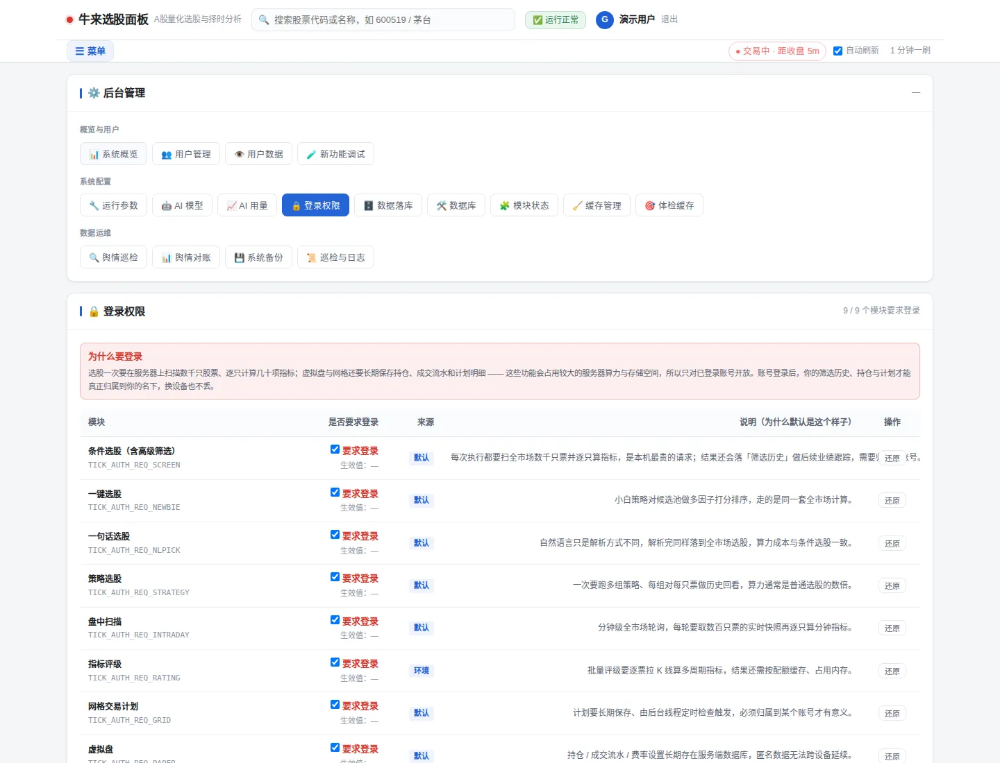

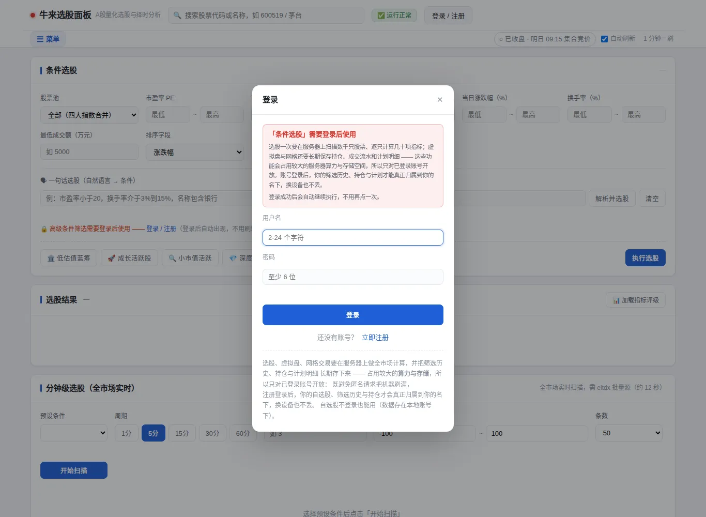

---

## 📁 目录结构

```
server/         FastAPI 后端：选股引擎 / 行情 / 龙虎榜 / 快讯 / 情绪 / 连板 / 题材雷达 / 虚拟盘
  app.py          主应用（171 个路由，含 /api/limitup /api/theme /api/factor_lab）
  run.py          启动器（读 $PORT，绑 0.0.0.0）
  newsfeed.py     双源快讯（新浪7x24 + 同花顺，去重 + TTL）
  sector_sentiment.py  板块舆情聚合：归类/利好/利空三张词表 + 板块词修正词典情绪（含 99 项防回归断言）
  sector_audit.py      舆情规则每日巡检：五条疑点规则 + markdown 报告 + 调度（只报告，不自动改词表）
  sector_verify.py     舆情收盘对账：交易日15:30用板块超额涨跌回验24h舆情方向准确率+错因研判（只对账，不自动改词表）
  hithink.py      同花顺特色数据：盘前竞价 / 权威日历 / 估值五口径 / 行情备源（#106~#108，含 46 项离线自检）
  sentiment.py    词典情绪（正/负词 + 否定反转 + 程度乘数 + 转折）
  limitup.py      连板梯队 + 6 阶段情绪周期（#100）
  ths_gold.py     宏观风向（降息概率/实际利率/期限利差/恐慌指数）+ 黄金行情六品种（同花顺黄金数据蒸馏，失败静默降级）
  theme_radar.py  题材雷达：四维评分 + 融合去重（#100）
  windowsim.py    窗口胜率回测 / 入选后表现（#105）
  holidays.py     本地 A 股节假日表（#104）
  store.py        数据访问层（SQLite / MySQL 协议库自适应）
web/            前端单页（原生 HTML/JS + ECharts，无构建步骤）
  index.html      全站单文件应用
docs/           部署指南与各功能说明（中文）+ screenshots/ 页面截图
tests/          自检与端到端测试（Playwright 双视口）
deploy.sh       一键启动 / 隧道 / 停止
requirements.txt 运行时依赖（轻量，无需 akshare/mootdx）
```

---

## 🤝 贡献方式

欢迎 Issue、PR 与建议！本项目以 **MIT** 开源，适合量化爱好者共同打磨。

- **报告 Bug / 提需求**：开 [Issue（Gitee）](https://gitee.com/jangviktor/niucap/issues) 或 [GitHub Issue](https://github.com/jangviktor-web/NiuCap/issues)，请尽量附上复现步骤、浏览器/系统、报错截图或日志（`server.log`）。
- **提交代码**：
  1. `fork` 本仓库并基于 `master` 切出特性分支（`feat/xxx` / `fix/xxx`）。
  2. 保持提交小而聚焦，提交信息建议带前缀：`feat(#号)` / `fix(#号)` / `docs` / `test` / `chore`。
  3. 前端改动请顺手跑 `tests/` 下相关自检（或说明手测结论）；新增功能不建议破坏现有模块（本项目遵循「纯增量、零回归」原则）。
  4. 发起 Pull Request，描述「改了什么 / 为什么 / 如何验证」。
- **数据源与许可**：核心行情依赖 `eltdx` 为**研究 / 学习专用许可（禁止商业使用）**；商用前请替换为其他合规数据源，并保持 `requirements.txt` 轻量。
- **代码风格**：后端 Python（PEP8 倾向），前端原生 JS（无打包），优先复用现有 helper，删除优于新增。

---

## 🗺️ 路线图

- [x] 选股复盘闭环：历史存档 + 胜率回测 + 入选后表现 + 批量加自选（#105）
- [x] 导航按「看盘/选股/分析/我的」四组分组（#106）
- [x] 虚拟盘收盘后禁止交易（#103）
- [x] 本地 A 股节假日表（#104）
- [x] 连板梯队 + 情绪周期 + 题材雷达（#100）
- [x] 移动端响应式导航（汉堡抽屉）+ 命令面板 + 交易时钟（#99）
- [x] 前端设计令牌根因修复与无障碍（#101）
- [ ] 形态识别 / 形态相似度可视化增强（#37 / #43）
- [ ] 自选股成本线可视化（#90）
- [ ] 个股页 hover 弹图（#92）
- [x] AI 个股深度分析卡片 + 策略解析 AI 增强（需 LLM Key）（#93 / ①②）
- [ ] 港美股适配（#94）

---

## ❓ 常见问题

**Q：页面能打开，但榜单 / 选股是空的？**
A：空库还没灌数据。看上面「[首次部署必读：数据初始化](#-首次部署必读数据初始化)」，进后台管理点一次「开始同步」即可。

**Q：需要 API Key 吗？收费吗？**
A：不需要，完全免费。行情来自腾讯 / 新浪 / 同花顺 / 东财公开接口，情绪分析为本地词典引擎。选填：同花顺的免费 API Key 配了之后，可在其他源全部故障时作为额外兜底；不配也完全能跑。

**Q：数据会更新吗？**
A：盘中行情缓存约 3 分钟自动刷新；日线支持每日定时自动同步（见 `.env` 配置）。

**Q：能多人同时用吗？**
A：能。配云端 MySQL 协议库（如 TiDB Cloud）后数据常驻，把部署链接或局域网地址分享给朋友即可。

**Q：休市 / 节假日打开，选股结果显示全 0 或涨跌为 0 正常吗？**
A：正常。当地没有新行情可比，入选价≈最新价，涨跌幅即 0。节假日表会让顶栏显示「休市 · 节假日」。

**Q：能用于实盘吗？**
A：本面板仅供量化学习与研究，不构成任何投资建议；虚拟盘可模拟交易，实盘决策风险自负。

---

## 📜 许可证

本项目以 **MIT 许可证**开源，仅供量化学习与研究，**不构成任何投资建议**。

依赖 `eltdx` 为 **研究 / 学习专用许可证（禁止商业使用）**；运行期已做容错（缺失时自动回落腾讯源），个人学习用途无碍，商用请替换为其他数据源。

---

<div align="center">

**用得上就点个 ⭐，有问题开 Issue～**

[](https://repostars.dev/?repos=jangviktor-web%2FNiuCap&theme=grape)

*仅供量化学习与研究，不构成投资建议。*

</div>

