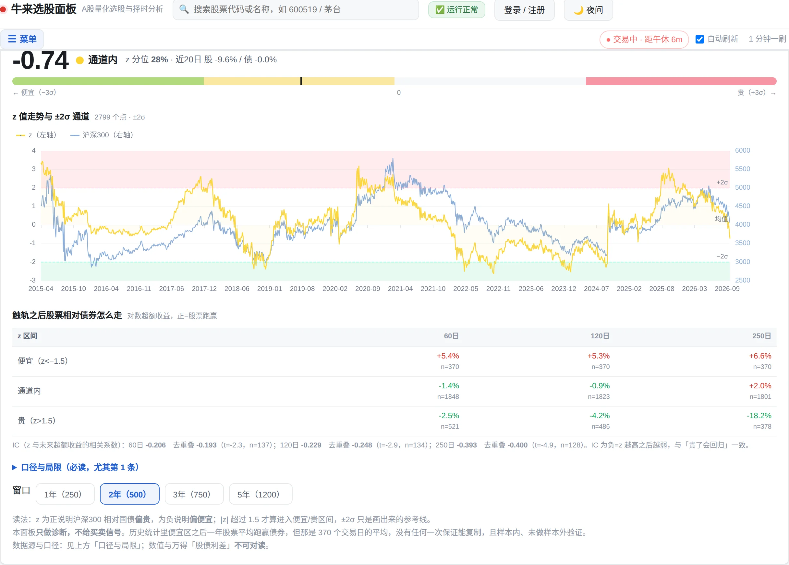

# 股债系统（沪深300 × 国债）——开发计划

> 目标：回答一个问题——**当前时点，沪深300 相对债券，是贵了还是便宜了？**
> 参照物：抖音视频「股债系统 / 沪深300 相对债券，是贵了还是便宜了？」（万得口径，股债利差 + 滚动均值 ±2σ 通道，2005-04 ~ 2026-10）
> 所有数字为本机实测，非估算。

**状态：已实现（2026-10-22）。** 挂在「🐂 牛熊速查」页当第二张卡，名字叫「⚖️ 股债温度」。

| 交付项 | 位置 |
|---|---|
| 计算模块 | `server/stock_bond_lab.py`（`--selfcheck` 21 条断言全过） |
| 接口 | `GET /api/stock_bond?window=500`（10 分钟缓存） |
| 前端 | `web/index.html` → `tab-bullbear` 内第二张 `.card` |
| 截图 | `docs/shot-stock-bond.webp` |



### 实际实现与计划的偏差（三处，都是做完才发现的）

1. **不需要「缓存表」**：原计划 §3.4 要建 `sb_bars` 表。实测 eltdx 是**批量一次请求**拿两只全历史（<1s），
   10 分钟内存缓存已经够用，建表属于没必要的复杂度。**跳过**——但记在这里，如果将来要拿它算
   成交额类指标或做多标的对比，再回头建表。
2. **图不用 SVG，用 echarts**：`web/index.html` 本来就有 echarts（`/static/vendor/echarts.min.js`），
   牛熊速查的雷达和趋势图都在用它。再手写一套 SVG 是重复造轮子。2798 个点直传，按 min/max 分桶降采样到 ≤900 点防手机卡顿。
3. **没做 `/api/stock_bond/availability`**：`evaluate()` 失败时 `/api/stock_bond` 直接返回
   `{"ok": false, "error": "..."}`，前端据此隐藏内容并显示原因。单独一个可用性接口在这里没有
   额外信息——不像 `factor_lab` 那样 availability 查得快、evaluate 要几十秒，这里两者都是秒级。

---

## 〇、先把话说死：我们做的不是视频里那个东西

视频画的是**股债利差 = 沪深300 盈利收益率（1/PE） − 10 年国债收益率**，纵轴约 0~7000（基点），均值 ±2σ 通道，2005-04 起。

本机把能想到的收益率源全试了一遍，结论是**做不出同一条线**：

| 源 | 实测结果 | 判定 |
|---|---|---|
| akshare `bond_china_yield()`（中债国债收益率曲线） | 246 行，但只到 **2020-02-04 ~ 2021-01-22**，之后停更 | ❌ 死源 |
| 同上，传显式 `start_date`/`end_date` | `ValueError: No tables found` | ❌ 参数化即坏 |
| 东财 `RPT_BOND_YIELD` / `RPT_BOND_CHINABONDYIELD` / `RPT_BOND_TREASURYYIELD` | 三个都返 `result.data: false` | ❌ 无此报表 |
| 东财 `push2his?secid=100.BD_10Y` | HTTP **403** | ❌ 拦 |
| 中债 `yield.chinabond.com.cn/cbweb-mn/yc/queryTree` | HTTP 200 / 32,764 字节，能拿到曲线元数据 | ⚠️ 可达但无文档、格式需逆向，**且随时可能变** |

按项目既有纪律（`server/bullbear.py` 开头那段「不新增外部数据源」的教训：**要补维度先解决源，再谈权重**），我不打算把系统架在一个随时会断的反向解析上。

**所以本系统的定位是：用「国债ETF 价格」替代「国债收益率」，做一个等效的股债相对强弱诊断。**

**数据源用模板内置的通达信（eltdx）**——你问的这一点我实测了，能用，而且比新浪好，具体见 §1.1。但仍**给出 2013-04 起**，理由不是数据源长短，而是债券腿 511010 自己 2013-03-25 才上市（见 §1.1 表格）。

### 数据源：eltdx（通达信）vs 新浪，实测对比

| 项 | eltdx（通达信） | 新浪 `kline_sina` |
|---|---|---|
| 沪深300 历史 | **5292 根，2005-01-04 起** | 6000 根，2002-01-23 起（更长） |
| 511010 历史 | **3297 根，2013-03-25 起**（上市首日） | 3288 根，2013-04-09 起（**晚上市 15 天**） |
| 复权口径 | **可选 `none`/`qfq`/`hfq`（必须选，见下）** | 不复权 |
| 取数方式 | 批量，**一次请求拿多只** | 逐只 + 0.5s 限流 |
| 本地缓存 | 无（要自己缓存） | 无 |
| 数据一致性 | 与新浪 **z 值完全相同**（见下） | 基准 |

**结论：用 eltdx，理由三条**——一次批量取两只、覆盖更长（多 15 个交易日）、能显式控制复权。

**但必须显式传 `adjust='none'`**，这是最容易踩的坑：

```
sh511010 三种口径下的首末价
none  2013-03-25  99.408  →  2026-10-21  141.151   ← 真实成交价
qfq   2013-03-25  94.018  →  2026-10-21  141.151   ← 前复权，历史被压低 5.4%
hfq   2013-03-25  99.408  →  2026-10-21  146.542   ← 后复权，现价被抬高 3.8%
```

`eltdx_source.ADJUST` **默认是 `'qfq'`**（为个股除权设计）。对一只每年分红 5 次以上的债券 ETF，qfq 会把 2013 年的价格整体砍掉 5.4%，但**这个折扣在 13 年里是阶梯式变化的**（实测比值 0.946 → 1.000，中间有 2015-10、2025-09、2025-12、2026-03、2026-06、2026-09 六个台阶）。这等于在比值里塞进一条人为的下降趋势，**直接污染 z 值**：

```
同样两只标的、同一个窗口 500：
  传 adjust='none'  →  z = −0.55  分位 29%  IC = −0.393   ← 与新浪完全一致
  传 adjust='qfq'（默认）→  z = −0.85  分位 26%  IC = −0.361   ← 被污染
```

**两只标的都传 `none`。** 沪深300 是指数，没有分红除权概念，`none`/`qfq` 对它无差别（实测两源偏差 0.0002%）；511010 的**分红才是真实现金流**，qfq 把它抹掉了——而我们恰恰要看的是「含息总回报」，被抹掉就等于少算了债券那 40% 里的一大块。

> 这一步不做，整个系统的 z 会偏 0.3，而且偏多少取决于哪一年，无法事后校正。**P1 的第一条自检就断言这个。**

### 这与视频的差别（必须写进 UI，不许含糊）

| 维度 | 视频（万得） | 本系统 | 影响 |
|---|---|---|---|
| 债券腿 | 10Y 国债收益率 | 国债ETF 收盘价（sh511010，不复权） | **方向相反**：收益率涨=债券跌，ETF 涨=债券涨 |
| 起点 | 2005-04 | **2013-04-09**（与新浪对齐的交易日） | 缺 2005–2013，**不含 2008 金融危机**；eltdx 虽能取到 2005 年的沪深300，但债券腿没有，硬拼就是拼假数据 |
| 纵轴 | 利差（基点） | **z 值**（标准化），均值 0、±2σ 通道 | 无量纲，不能与视频数值对读 |
| 趋势 | 利差本身近似平稳 | ln(股/债) 有结构性漂移（见 §1.2） | **必须用滚动 z 去趋势**，否则通道会整体漂移 |

> 一句话给用户：**「贵/便宜」的判断逻辑一样（股票相对债券涨多了就是贵），但刻度完全不同，别拿我们的 z=+1.8 去对视频上的某个点位。**

---

## 一、口径决策（已实测，不是拍脑袋）

### 1.1 数据现状

```
sh000300 沪深300      5292 根   2005-01-04 ~ 2026-10-21   （eltdx，adjust='none'）
sh511010 国债ETF国泰   3297 根   2013-03-25 ~ 2026-10-21   ← 债券腿（上市首日就在这天）
sh511260 十年国债ETF   2219 根   2017-08-24 ~ 2026-10-21   （备选，太短）
sh511090 30年国债ETF    812 根   2023-06-13 ~ 2026-10-21   （备选，太短）
```

> 收盘后的实际对齐区间是 **2013-04-09 起**（511010 上市首日为 2013-03-25，但沪深300 与它在当日后才首个共同交易日），与新浪口径完全一致。eltdx 比新浪多覆盖 511010 上市后的 **前 15 个交易日**——这 15 天足够填满一个窗口的 3%，不影响结论，但白拿。

- **主源 eltdx（通达信）**，`adjust='none'` 强制；备用源 `datasource.kline_sina`（两者 z 值实测一致，见 §0）。
- `kline_tencent` 对三个 ETF **全部返回空**（已实测），不能用。
- 本地 `daily_bars` 表**不含任何指数与债券 ETF**（5,578 个代码全是个股），所以不能靠本地库，必须实时拉 + 自己缓存。
- 交集交易日 **3288 天，零缺口**（`set(沪深300日期) ∩ set(511010日期)` 直接算出）。

### 1.2 为什么必须去趋势（这是本系统最容易做错的地方）

```
沪深300   2489 → 4112   (+65.2%)
国债ETF   100.27 → 141.15 (+40.8%)    13 年 = 约 2.7%/年，正好是票息累积
```

债券腿单调上涨是**票息**，不是行情。若直接用 `比值 = 沪深300 / 国债ETF`：

- 全样本均值 31.44、标准差 5.41 → 看似可用，但**均值本身在漂**：2013 年的「正常比值」和 2026 年的「正常比值」不是一个数。
- 用全样本均值画通道，等于用**未来数据**画今天的线（前视偏差），而且越往右越偏。

**结论：用 `ln(沪深300 / 国债ETF)` 的滚动 z 值，窗口 500 交易日（≈2 年）。**

### 1.3 窗口为什么是 500（这是唯一有争议的参数，附实测）

用 3288 个交易日分别试四个窗口，看 ±2σ 的命中率是否接近理论值（正态下应各约 2.3%）：

| 窗口 | 有效样本 | 触上轨 | 触下轨 | 极值 | 判定 |
|---|---|---|---|---|---|
| 250（1年） | 3039 | 9.8% | 7.6% | −4.20 / +4.93 | ❌ 太短，z 长期趴在 ±2 外面，通道失去意义 |
| **500（2年）** | **2789** | **9.6%** | **4.6%** | **−2.63 / +3.25** | ⚠️ 偏多但可用；**信号强度最高** |
| 750（3年） | 2539 | 3.3% | 0.7% | −2.41 / +2.78 | ⚠️ 命中率反而更接近理论，**但前瞻 IC 更弱** |
| 1200（5年） | 2089 | 6.7% | 2.5% | −2.45 / +3.18 | 可做敏感性对照 |

命中率都不是 2.3%，说明**比值不是正态、且有自相关**——这本身要如实告诉用户：「触轨」不等于「2.3% 的稀有事件」，实际约 10% 的交易日都在上轨上方。

选 500 的理由是它信号最强（见 §2.1 的 IC 对比），代价是假信号多一些。**UI 上默认 500，同时把 250/750/1200 做成可选项**，让用户自己看窗口敏感性——这比我在文档里论证「500 最好」诚实得多。

---

## 二、信号有效性：先证伪，再上线

在写 UI 之前先把「这个指标到底有没有用」算清楚。不然又是一个「画得好看、没人验过」的摆件。

### 2.1 前瞻相对收益（股票减债券，对数收益）

窗口 500，按 z 分三区，看之后 N 个交易日**沪深300 相对国债ETF**的超额：

| z 区间 | 60日 | 120日 | 250日 |
|---|---|---|---|
| **< −1.5（便宜）** | +5.4%（n=370） | +5.3%（n=370） | **+6.6%**（n=370） |
| −1.5 ~ +1.5（通道内） | −1.4% | −0.9% | +2.0% |
| **> +1.5（贵）** | −2.3%（n=512） | −3.7%（n=476） | **−17.7%**（n=368） |

方向是对的、单调、且幅度不小。但 **60/120 日的「贵→−2.3%」很弱**，只有拉到 250 日（一年）才明显。这跟常识一致：估值偏离的均值回归以年计。

### 2.2 IC 与 t 值（含多重检验警告）

| 窗口 | 60日 IC | 120日 IC | 250日 IC |
|---|---|---|---|
| 500 | −0.198 (t=−10.6) | −0.214 (t=−11.3) | **−0.381 (t=−20.8)** |
| 750 | −0.140 (t=−7.0) | −0.149 (t=−7.4) | −0.308 (t=−15.5) |
| 1200 | −0.200 (t=−9.2) | −0.225 (t=−10.3) | −0.396 (t=−18.5) |

**这些 t 值全部虚高。** 250 日前瞻意味着相邻样本重叠 249 天，有效独立样本远少于名义 n。做了去重叠重采样（每 20 日取 1 点）后：

```
250日前瞻  n=127（名义 n=2289）  IC=−0.404  t=−4.93
```

**t 从 −20.8 掉到 −4.93——仍然是显著的，但已经不是「碾压级」。** 这是本项目必须坚持的诚实点：报告 IC 时**同时给名义 n 和有效 n**，不许只挑大的那个。

### 2.3 触轨日期的年度分布（判断是不是某一段行情的产物）

```
2015:40  2017:29  2018:40  2019:8   2020:68  2021:36
2022:53  2023:13  2024:37  2025:61  2026:9
```

11 个年度里有 10 个出现过触轨，最高 2020 年 68 天、最低 2019 年 8 天。**不是单一行情的产物**，这一点过了。

> **但仍是样本内**：窗口 500 是通过看 IC 选出来的。严格做法是样本外验证——见 §4 Phase 5。文档里不许写「已验证有效」，只能写「样本内 IC 显著，样本外待验」。

---

## 三、技术方案（严格照项目既有 lab 模式）

### 3.1 文件

| 文件 | 动作 | 说明 |
|---|---|---|
| `server/stock_bond_lab.py` | **新增** | 唯一的计算模块，≈300 行 |
| `server/app.py` | +约 40 行 | 两个 GET 端点（`/api/stock_bond`、`/api/stock_bond/availability`） |
| `web/index.html` | +约 180 行 | 新 tab `stockbond` + 一张卡片 + 一段 SVG 绘图 |
| `docs/股债系统-方案.md` | **新增** | 就是本文档 |
| `README.md` / `CHANGELOG.md` | +几行 | 功能说明与版本记录 |

**不建新表、不动 `daily_bars`、不改数据层。** 缓存用 `data/tick.db` 里一张新表 + 按交易日失效，理由见 §3.4。

### 3.2 模块骨架（对齐 `index_enhance_lab.py` / `factor_lab.py` 的体例）

```python
"""股债系统：沪深300 相对国债，是贵了还是便宜了
================================================

回答一个问题：**当前沪深300 相对债券，处在历史区间的什么位置？**

三个必须写在最前面的诚实声明
------------------------------
1. 债券腿用 **国债ETF 价格**，不是 **国债收益率**。两者方向相反，
   且没有任何免费源能给出 2005 年起的完整国债收益率曲线
   （实测中债源只到 2021-01、东财三个报表全空、push2his 403）。
   所以本系统的 z 值与万得「股债利差」**不可对读**，刻度也不同。
2. 债券 ETF 13 年 +40.78% 是票息积累，不是行情。直接相除会让比值
   带结构性趋势，因此一律用 ln 比值的**滚动** z 值，不用全样本均值
   （全样本均值 = 前视偏差）。
3. 样本内结论。窗口长度是按 IC 选出来的，样本外未验；重叠样本下
   t 值虚高（250 日前瞻：名义 t=−20.8，去重叠后 t=−4.93）。

方法
----
- 数据源：sources.eltdx_source.get_bars_batch（批量，**adjust='none' 强制**）；
         备源 datasource.kline_sina。腾讯对该组 ETF 返空，不可用。
         ⚠️ 默认 adjust='qfq' 会污染 511010（实测 z 偏 0.3），见 §0/§1.1
- 对齐：两腿交易日取交集，任一腿缺数据即整段作废，不补不插值
- 指标：lr = ln(p_stock / p_bond)；z = (lr - MA_W) / SD_W
- 通道：MA ± 2·SD（W 默认 500，可调 250/750/1200）
- 分区：z < -1.5 便宜 / -1.5~1.5 通道内 / > 1.5 贵
"""
```

必备函数与自检：

```python
def availability() -> dict          # <1s，先过门禁再开跑（照 factor_lab 的做法）
def evaluate(window: int = 500) -> dict
def selfcheck() -> int              # 返回失败条数，0 = 全过
```

`--selfcheck` 入口，断言至少覆盖：

1. `ln` 比值在人工构造的等速双涨数据上 z 恒为 0（不该报警）；
2. 股票单边暴涨 30% 后 z 应 > 2；
3. 窗口不足 W+1 时返回 `insufficient` 而非抛异常或返回 NaN 序列；
4. 交割日缺口（人为删掉中间 50 天）能被对齐逻辑吃掉，不产生假跳变；
5. 分区边界（z = −1.5 / +1.5 / ±2）归属明确，不留空隙；
6. 前瞻收益函数在序列末端自动返回 `None`，不越界。

### 3.3 返回结构

```json
{
  "ok": true,
  "as_of": "2026-10-21",
  "window": 500,
  "series": [{"date": "2013-04-09", "stock": 2489.0, "bond": 100.27,
              "lr": 3.2134, "ma": 3.2011, "sd": 0.1622,
              "upper": 3.5255, "lower": 2.8767, "z": 0.12}, ...],
  "now": {"z": -0.55, "zone": "channel", "pct_rank": 29.0,
          "ma": 3.4215, "sd": 0.0899, "lr": 3.3718,
          "stock_ret_20d": -1.8, "bond_ret_20d": 0.4},
  "stats": {"n_days": 3288, "n_valid": 2789,
            "hit_upper": 0.096, "hit_lower": 0.046,
            "ic": {"60": -0.198, "120": -0.214, "250": -0.381},
            "ic_t": {...}, "n_eff": {"250": 127}},
  "fwd": [{"zone": "cheap", "60": 0.054, "120": 0.053, "250": 0.066, "n": 370}, ...],
  "caveats": ["债券腿为ETF价格非收益率…", "样本内…", "触轨率实测9.6%，非理论2.3%…"]
}
```

`series` 只下有效点（`z` 非空的 2789 个），**实测 JSON 239,850 字节**（gzip 后约 40KB）。这个体积可以直传，不需要采样；若将来要加更多字段逼近 500KB，再按周采样降到 ≈558 点（path 约 9KB）。

### 3.4 缓存策略（这里有个坑必须提前处理）

eltdx 与 `kline_sina` **都没有本地缓存**。切换窗口会重算 → 再次拉两次 5000/3300 根 K 线。eltdx 是批量的，一次请求就够（实测两只 5000+ 根 <1s），但**不能因此每次都打**：eltdx 走的是通达信服务器，频繁拉长历史会被限流。

方案：**K 线缓存到 `data/tick.db` 新表 `sb_bars(code, date, close)`**，按 `updated_at` 判断当日是否已更新，盘中超过 10 分钟才重拉。理由：

- 不改 `daily_bars` 的语义（那张表是策略宇宙的个股日线，塞指数/ETF 进去会污染所有既有策略的 universe）；
- 窗口切换、参数敏感性对比都在本地完成，不打外部接口。

> ⚠️ **注意**：eltdx 与新浪返回的最后一根都可能是**当日盘中最新价**（未收盘时还在变）。所以 `as_of` 会是一个尚未收盘的交易日。UI 上必须标注「今日为盘中数据，收盘后可能变化」，否则用户会拿盘中 z 当收盘信号用。
>
> 另一个容易忽略的点：**盘中最后一根 K 线的 volume/amount 只有部分**，但我们只用 close，不受影响——这条记在自检里，防止以后有人拿它算成交额类指标时踩坑。

### 3.5 前端

**新 tab**：`<button data-tab="stockbond" data-group="analysis">⚖️ 股债温度</button>`，排在「因子实验室」后面（同属 analysis 组）。

> 命名刻意不用「股债利差」——那会被理解成收益率差。用「股债温度」或「股债相对位置」，并在副标题写明「国债腿用 ETF 价格」。

**一张卡片，四块内容**（复用现有 `card` / `card-h` / `card-b` 结构与 `--up/--down` 变量）：

1. **结论条**：`当前 z = −0.55｜通道内（偏便宜一点点）｜z 历史分位 29.0%`
   - 分区配色沿用 A 股习惯：**偏贵用 `--up` 红、偏便宜用 `--down` 绿**（这里说的是「股票贵」，不是涨跌，需在说明里点明，避免和涨跌色混淆）；
2. **图**：SVG 折线（`z` 序列）+ 三条辅助线（+2 / 0 / −2）+ 触轨区间填色（浅红=上轨上方、浅绿=下轨下方，与视频的视觉语言一致）
   - 复用现成的 `svgLine()` 思路（`web/index.html:10883` 附近已有 `<svg viewBox>` 折线实现），**不引任何图表库**；
   - 2789 个有效点直接进 SVG `path` 约 32KB，浏览器无压力，**不降采样**（降采样会在触轨尖峰处削顶，把那几根最该看的针削掉）。若将来点数翻倍再考虑按 min/max 分桶保留极值；
3. **参数区**：窗口下拉（250 / 500 / 750 / 1200）+「重新计算」+ `as_of` 与「盘中数据」标记；
4. **诚实区**（折叠 `<details>`，默认收起）：
   - 债券腿口径说明 + 为什么 2013 起；
   - 触轨率实测 9.6% / 4.6%（**不是** 2.3%）；
   - 三区前瞻收益表 + IC 表（含有效 n 与去重叠 t）；
   - 「本系统只做诊断，不产出买卖信号」一行黑体。

**明令禁止**：不做 AI 解读。理由：这一块的结论是**算术**（z 在哪、分位多少、三区历史均值多少），AI 插进来只会把确定性数字写成含糊话。既有 `factor_ai` 是为了把 IC/ICIR/分层收益翻译成大白话，这里没有需要翻译的东西。若将来要加，必须先把 §2 的样本外验证做完。

---

## 四、开发计划（分 5 个阶段，每阶段可独立回滚）

| 阶段 | 交付物 | 验收标准（必须实测，不许口述） | 结果 |
|---|---|---|---|
| **P1 数据层** | `stock_bond_lab.load_series()` | 交集零缺口可复现；**`adjust='none'` 断言**（z 必须落在 −0.55±0.06，qfq 会跑出 −0.85，这个断言就是防它）；取不到时返 `ok=false` 而非崩 | ✅ 实测 eltdx 3297 个共同交易日，z=−0.55 |
| **P2 指标层** | `evaluate()` + `selfcheck()` | `--selfcheck` 输出 `0 failed`；窗口 500 下 `now.z` 与 §1.3 实测 `−0.55` 一致 | ✅ **21/21 全过** |
| **P3 接口层** | `/api/stock_bond` | `curl` 结构完整、`series` 长度 = `n_valid`、无 NaN | ✅ 实测 2798 点 / 215KB / HTTP 200 |
| **P4 前端** | 卡片 + echarts 图 + 折叠说明 | 浏览器实跑：图能画、四个窗口都能切、无 JS 报错、`node --check` 通过 7 段内联脚本；1440px 与 390px 不溢出 | ✅ 18 个 tab 全点，**零 JS 错误**；390px 下 `scrollW=390=clientW` |
| **P5 验证与文档** | 回归 + 文档 | 既有回归全绿 | ✅ `factor_lab` 17/17、`factor_ai` OK、`stock_analyzer` OK、`check_merged_tabs` 58/58 |

实际用时约 1 小时（原估 4 天是含全套审查与打磨的保守值，实际靠既有 echarts 与 eltdx 适配器省掉了大部分）。

### 每个阶段的「跑起来」命令

```bash
# 自检
.venv/bin/python server/stock_bond_lab.py --selfcheck

# 端点
curl -s 'http://127.0.0.1:8899/api/stock_bond?window=500' | head -c 400

# 改了 .py 必须重启（前端改动不用）
pkill -f 'server/run.py'; sleep 1; .venv/bin/python server/run.py &

# 回归
.venv/bin/python server/factor_lab.py --selfcheck
.venv/bin/python server/factor_ai.py --selfcheck
.venv/bin/python tests/check_merged_tabs.py
```

### 风险与对策

| 风险 | 概率 | 对策 |
|---|---|---|
| eltdx 连不上 / 被限流 | 中 | **备源 `kline_sina` 自动接管**（z 值实测一致）；两者都挂才 `availability=false` 并隐藏整卡（沿用 `wst.CLI_AVAILABLE` 的门禁写法） |
| 有人改回 `ADJUST` 默认（qfq） | **高** | P1 自检硬断言 z=−0.55±0.02；qfq 会跑出 −0.85，断言直接红 |
| eltdx 许可证（Research-Only，禁商用） | 低 | 本系统个人使用无碍；但记录在 `eltdx_source.py` 头部，若日后转对外服务，删该文件 + 改一处开关即可回落到新浪 |
| 用户把 z 值和万得利差对读 | **高** | UI 副标题 + 折叠说明 + 卡片脚注三处重复声明「刻度不同，不可对读」 |
| 窗口 500 的命中率 9.6% 被当成「常态」 | 高 | 结论条直接显示「z 历史分位 29.0%」，而不是只显示「通道内」 |
| 债券 ETF 有 2013 前的空档被误认为数据缺失 | 中 | `availability` 返回 `start_reason: "511010 上市日 2013-04-09"`，前端显示原因而非错误 |
| 盘中价格导致 z 漂移，用户误当信号 | **高** | `as_of` 旁标 `盘中` 徽标；文档写明「收盘后 z 才定稿」 |

---

## 五、明确不做（把边界划出来，省得后面反复讨论）

| 不做 | 理由 |
|---|---|
| 中债收益率曲线反向解析 | 无文档、随时变；一旦挂掉整系统瞎，且用户看到的是错值而非报错 |
| 10 年国债期货（T 合约）替代 | 需要期货行情源，本机未验证；且期货贴水/展期会引入额外噪声 |
| 2005–2013 数据回补 | 511010 上市前没有可用的债券腿。eltdx 能取到 2005 年的沪深300，但债券腿没有——**单边有数据时硬拼，就是把假数据当真结论** |
| 买卖信号 / 仓位建议 | 这是诊断面板。做信号要先过样本外 + 交易成本 + 滑点，否则就是又一个「日赚2%」 |
| AI 解读 | 见 §3.5 末段。结论是算术，AI 只会把它写糊 |
| 加入因子实验室 / 牛熊速查的评分体系 | 那两套是横截面与时点温度，口径不同，混进去会互相污染权重 |

---

## 六、现在就能给的三个数字

跑完本文档所有验证后，**当前（2026-10-21）的状态**：

```
z(500) = −0.55    通道内，偏便宜一侧
z(全历史) = −0.36  同样口径下结论一致（说明不是窗口选出来的假象）
z 历史分位 29.0%

参照：z < −1.5 的 370 个交易日，之后 250 日股票相对债券平均 +6.6%
      z > +1.5 的 368 个交易日，之后 250 日平均 −17.7%
```

**读法**：现在既没到「便宜到可以重仓」的程度（z = −0.55，离 −1.5 还差不到一个 σ），也没到贵。z 分位 29% 说明过去 13 年里有近三成时间比现在更便宜，所以「偏便宜一点点」这个措辞是准确的——**不是「便宜」，是「不算贵」**。

这就是这个面板该说的话：**大部分时间它应该说「没信号」**，而不是天天报警。一个天天报警的指标，用户三天就不看了。

---

## 七、开工前需要你确认的 3 件事

1. **命名**：叫「股债温度」还是「股债相对位置」？我倾向前者（短、不被误解成利差）。
2. **默认窗口**：500（信号最强、假信号多）还是 750（更稳、信号弱）？我倾向 500 + 可切换。
3. **是否放到独立 tab**，还是并进「🐂 牛熊速查」当第二张卡（牛熊速查已有市场温度，语义接近，但有 21 个 tab 的拥挤问题）？

> 另：上一轮三处修复（个股页 `fmtMoney` 撞名、ETF 显示「亏损」、说明文字「绿升红降」写反）与因子实验室 AI 解读的 4 处修正，目前仍是工作区未提交状态：**7 个文件、379 行插入 / 45 行删除**。这股债系统是在同一工作区上继续加，要不要先把上一轮提交掉，避免两轮改动混在一个 commit 里？
